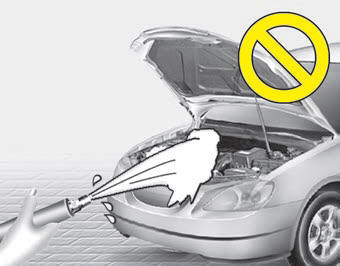

# Kia Sportage: Manutenção Final

[Home](../../index.md) / [Manual do Proprietário do Kia Sportage SL](../sportage-1236.md) / [Manutenção](sportage-1629.md) / [Cuidados de Apresentação](sportage-1687.md) / [Cuidados Externos](sportage-1688.md) / Manutenção Final

**Lavagem**

Para ajudar a proteger a fina do seu veículo contra ferrugem e deterioração, lave-o
completamente e frequentemente, pelo menos uma vez por mês, com água morna ou fria.

Se você usar o veículo para passeios off-road, deve lavá-lo após cada viagem off-road.
Preste atenção especial à remoção de qualquer acúmulo de sal, sujeira, lama e outros materiais
estranhos. Certifique-se de que as fendas de drenagem nas laterais inferior das portas e
dos painéis de roque se mantenham limpas e livres de obstruções.

Insetos, asfalto, resina de árvores, fezes de pássaros, poluição industrial e depósitos
semelhantes podem danificar a fina do seu veículo se não forem removidos imediatamente.

Mesmo uma lavagem rápida com água pura pode não remover completamente todos esses depósitos.
Pode ser usado sabão suave, seguro para superfícies pintadas.

Depois de lavar, lave o veículo com água morna ou fria. Não permita que o sabão seque na fina.

Depois de lavar o veículo, teste os freios ao dirigir lentamente para verificar se eles
foram afetados pela água. Se a performance de freio for prejudicada, seque os freios
aplicando-os suavemente enquanto mantendo uma velocidade lenta.

**Lavagem a Alta Pressão**

- Ao usar lavadoras a alta pressão, certifique-se de manter uma distância adequada
do veículo. Falta de clearance ou pressão excessiva podem levar a danos a componentes
ou à penetração de água.
- Não lave diretamente a câmera, sensores ou suas áreas circundantes com uma
lavadora a alta pressão. O choque aplicado por água a alta pressão pode causar o dispositivo
a não funcionar corretamente.
- Não aproxime a ponta do cano próximo a calçados (coberturas de borracha ou plástico) ou
conectores, pois eles podem ser danificados se entrarem em contato com água a alta pressão.

CAUTION - Encharcamento do Motor

- *Lavagem com água no compartimento do motor, incluindo lavagem a alta pressão, pode causar
falhas nas circuitos elétricos localizados no compartimento do motor.*
- *Nunca permita que água ou outros líquidos entrem em contato com componentes elétricos/eletrônicos
do veículo, pois isso pode danificá-los.*

**Aplicação de Cera**

Aplique cera no veículo quando a água não mais pingar na pintura.

Lave e seque o veículo antes de aplicar cera. Use uma cera líquida ou em pasta de boa qualidade,
e siga as instruções do fabricante. Cerase todos os acabamentos metálicos para protegê-los
e manter seu brilho.

Remover óleo, asfalto e outros materiais semelhantes com um removível de manchas geralmente
retira a cera da fina. Certifique-se de reaplicar cera nessas áreas mesmo se o resto do veículo
ainda não precisar de cera.

CAUTION - Secagem do Veículo

- *Esfregar poeira ou sujeira na carroceria com um pano seco pode arranhar a fina.*
- *Não use esponjas de aço, limpeas abrasivas, detergentes ácidos ou detergentes fortes.*

contendo agentes alcalinos ou cáusticos em partes revestidas com cromatização ou alúminio anodizado. Isso pode resultar em danos ao revestimento protetor e causar descoloração ou deterioração da pintura.*
