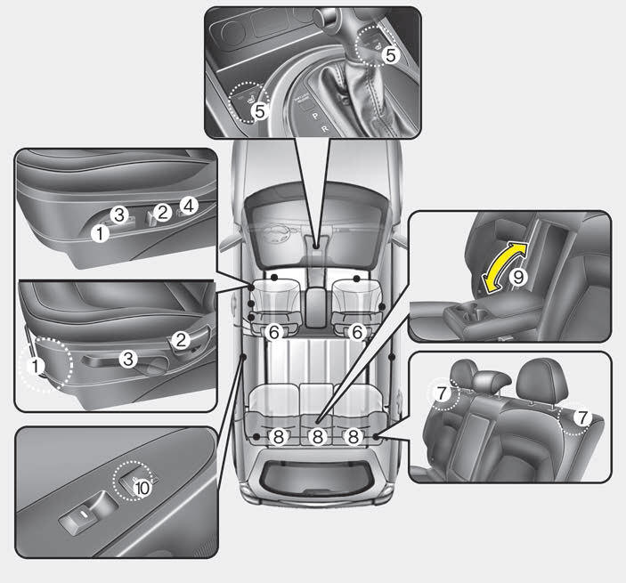
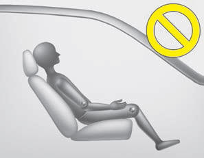

# Kia Sportage: Assentos

[Home](../../index.md) / [Manual do proprietário Kia Sportage SL](../sportage-1236.md) / [Recursos de segurança do seu veículo](sportage-1249.md) / Assentos

**Assento dianteiro**

(1) Avanço e recuo

(2) Ângulo do encosto

(3) Altura do encosto do assento (assento do motorista)

(4) Apoio lombar (assento do motorista)*

(5) Aquecimento do assento (com ventilação)*

(6) Travesseiro

**Assento da segunda fila**

(7) Ângulo do encosto e dobragem

(8) Travesseiro

(9) Puxador

(10) Aquecimento do assento*

AVISO - Objetos soltos

*Não coloque nada no compartimento dos pés do motorista ou sob os assentos dianteiros.
Objetos soltos na área dos pés do motorista podem interferir na operação dos pedais.*

AVISO - Dobre o encosto

*Não pressione o botão de liberação do encosto do assento sem segurar e controlar o encosto.
O encosto do assento pode se levantar repentinamente, possivelmente impactando você ou outros passageiros.*

AVISO - Responsabilidade do motorista pelos passageiros

**

*O motorista deve orientar o passageiro a manter o encosto do assento em posição ereta
quando o veículo estiver em movimento. Se um assento estiver inclinado durante um acidente,
o quadril do ocupante pode deslizar sob a parte do cinto de segurança do quadril, aplicando
grande força ao abdômen não protegido.*

AVISO - Encosto do assento

*Os ocupantes nunca devem sentar-se em almofadas de assento aftermarket ou almofadas de assento.
O quadril do passageiro pode deslizar sob a parte do cinto de segurança do quadril durante um
acidente ou uma parada repentina.*

AVISO - Assento do motorista

- *Nunca tente ajustar o assento enquanto o veículo estiver em movimento. Isso pode
	resultar em perda de controle do veículo.*
- *Não permita que qualquer objeto interfira na posição normal do encosto do assento e do ajuste do encosto.
Armazenar itens contra o encosto do assento pode resultar em ferimentos graves ou fatais
em uma parada repentina ou colisão.*
- *Sente-se o mais para trás possível do volante, mantendo ainda assim o controle confortável do veículo.
Recomenda-se uma distância de pelo menos 10" entre o peito e o volante. Falhar nisso pode resultar em ferimentos por inflação do airbag ao motorista.*

AVISO - Encostos traseiros

*Sempre trave os encostos traseiros antes de dirigir. Falhar nisso pode resultar
em passageiros ou objetos sendo projetados para frente, ferindo ocupantes do veículo.*

AVISO - Bagagem e Carga

*Não empilhe bagagens ou carga mais alta que o encosto do assento na área de carga.
Em um acidente, a carga pode atingir e ferir um passageiro. Se os objetos forem grandes, pesados ou precisarem ser empilhados,
devem ser amarrados na área de carga.*

AVISO - Área de Carga

*Não permita que passageiros viajem na área de carga sob nenhuma circunstância.*

A área do porta-malas é exclusivamente para o transporte de bagagem ou carga.*

AVISO - Movimento inesperado do assento

*Depois de ajustar um assento manualmente, sempre verifique se ele está trancado
movimentando seu peso para frente e para trás. Um movimento súbito ou inesperado do assento do motorista pode causar a perda do controle do veículo.*

AVISO - Ajuste do assento

- *Não ajuste o assento usando cinto de segurança. Movimentar o assento para frente
irá causar uma forte pressão no abdômen.*
- *Não coloque a mão perto do assento ao ajustá-lo. Sua mão pode ficar presa na mecanização do assento.*

AVISO - Objetos Pequenos

*Use extrema cautela ao retirar objetos pequenos presos sob os assentos ou
entre o assento e o console central. Suas mãos podem ser cortadas ou feridas pelas bordas afiadas do mecanismo do assento.*

- [Ajuste do assento frontal - manual](sportage-1251.md)
- [Ajuste do assento frontal - elétrico](sportage-1255.md)
- [Aquecimento do assento frontal](sportage-1261.md)
- [Ajuste do assento traseiro](sportage-1263.md)
