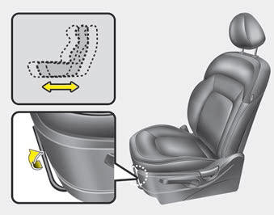

# Kia Sportage: Frente e trás

[Home](../../index.md) / [Manual do proprietário Kia Sportage SL](../sportage-1236.md) / [Recursos de segurança do seu veículo](sportage-1249.md) / [Assentos](sportage-1250.md) / [Ajuste do assento dianteiro - manual](sportage-1251.md) / Frente e trás

Para mover o assento para frente ou para trás:

1. Empurre o lembrete de ajuste do assento para cima e segure-o.

2. Desloque o assento para a posição desejada.

3. Solte o lembrete e certifique-se de que o assento está bloqueado.

Ajuste o assento antes de dirigir e certifique-se de que o assento está bloqueado
corretamente tentando movê-lo para frente e para trás sem usar o lembrete. Se o assento se mover, ele não está bloqueado corretamente.
