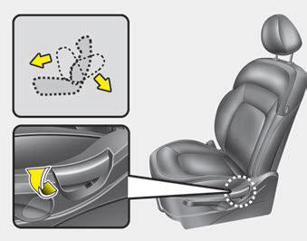

# Kia Sportage: Ângulo do encosto do assento

[Home](../../index.md) / [Manual do proprietário do Kia Sportage SL](../sportage-1236.md) / [Recursos de segurança do seu veículo](sportage-1249.md) / [Assentos](sportage-1250.md) / [Ajuste do assento dianteiro - manual](sportage-1251.md) / Ângulo do encosto do assento

Para inclinar o encosto do assento:

1. Incline-se ligeiramente para frente e levante o gancho de inclinação do encosto do assento.

2. Incline-se lentamente para trás no assento e ajuste o encosto do assento para a posição desejada.

3. Solte o gancho e certifique-se de que o encosto do assento está bloqueado em seu lugar.

(O gancho DEVE retornar à sua posição original para que o encosto do assento seja bloqueado.)
