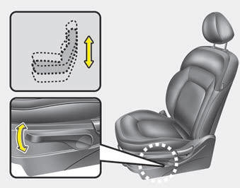

# Kia Sportage: Altura do assento (para o assento do motorista)

[Home](../../index.md) / [Manual do proprietário Kia Sportage SL](../sportage-1236.md) / [Recursos de segurança do seu veículo](sportage-1249.md) / [Assentos](sportage-1250.md) / [Ajuste do assento dianteiro - manual](sportage-1251.md) / Altura do assento (para o assento do motorista)

Para alterar a altura do assento, empurre o engrenagem para cima ou para baixo.

- Para baixar a almofada do assento, empurre o engrenagem várias vezes para baixo.
- Para levantar a almofada do assento, puxe o engrenagem várias vezes para cima.
