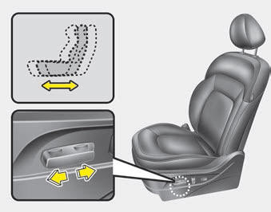

# Kia Sportage: Frente e trás

[Início](../../index.md) / [Manual do proprietário do Kia Sportage SL](../sportage-1236.md) / [Recursos de segurança do seu veículo](sportage-1249.md) / [Assentos](sportage-1250.md) / [Ajuste do assento do passageiro dianteiro - elétrico](sportage-1255.md) / Frente e trás

Empurre o botão de controle para frente ou para trás para mover o assento para a posição desejada.
Solte o botão quando o assento atingir a posição desejada.
