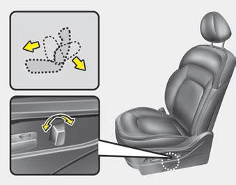

# Kia Sportage: Ângulo do respaldo do assento

[Home](../../index.md) / [Manual do proprietário do Kia Sportage SL](../sportage-1236.md) / [Recursos de segurança do seu veículo](sportage-1249.md) / [Assentos](sportage-1250.md) / [Ajuste do assento dianteiro - elétrico](sportage-1255.md) / Ângulo do respaldo do assento

Empurre o botão de controle para frente ou para trás para mover o respaldo do assento para o ângulo desejado. Solte o botão uma vez que o assento atingir a posição desejada.
