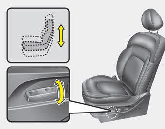

# Kia Sportage: Altura do assento (para o assento do motorista)

[Home](../../index.md) / [Manual do proprietário Kia Sportage SL](../sportage-1236.md) / [Recursos de segurança do seu veículo](sportage-1249.md) / [Assentos](sportage-1250.md) / [Ajuste do assento dianteiro - elétrico](sportage-1255.md) / Altura do assento (para o assento do motorista)

Puxe a parte traseira do interruptor de controle para cima para levantar ou pressione para baixo para abaixar o encosto do assento. Solte o interruptor uma vez que o assento atinja a posição desejada.
