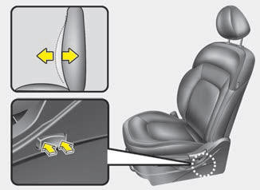
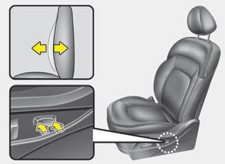

# Kia Sportage: Suporte lombárico (para o assento do motorista)

[Home](../../index.md) / [Manual do proprietário Kia Sportage SL](../sportage-1236.md) / [Recursos de segurança do seu veículo](sportage-1249.md) / [Assentos](sportage-1250.md) / [Ajuste do assento dianteiro - elétrico](sportage-1255.md) / Suporte lombárico (para o assento do motorista)

Tipo A

Tipo B

O suporte lombárico pode ser ajustado pressionando o botão.
