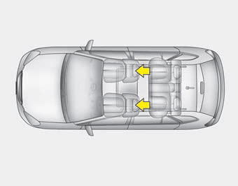
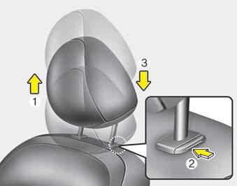
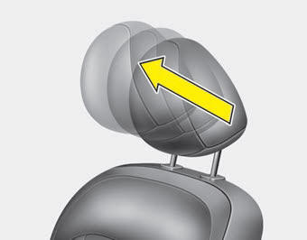
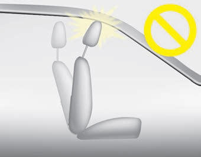
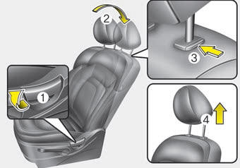
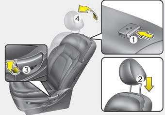
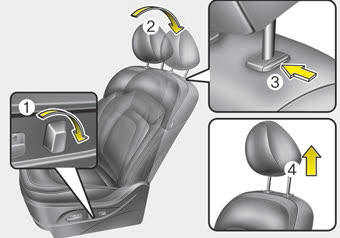
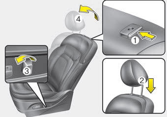
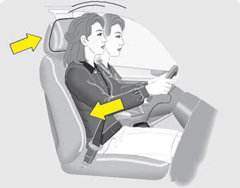

# Kia Sportage: Traseira de cabeça

[Home](../../index.md) / [Manual do proprietário Kia Sportage SL](../sportage-1236.md) / [Recursos de segurança do seu veículo](sportage-1249.md) / [Assentos](sportage-1250.md) / [Ajuste do assento dianteiro - elétrico](sportage-1255.md) / Traseira de cabeça

Os assentos do condutor e do passageiro dianteiro estão equipados com uma traseira de cabeça para a segurança e conforto do ocupante.

A traseira de cabeça não oferece apenas conforto para o condutor e passageiro dianteiro, mas também ajuda a proteger a cabeça e o pescoço em caso de colisão traseira.

Para maximizar a eficácia em caso de acidente, a traseira de cabeça deve ser ajustada de forma que o centro da traseira de cabeça esteja na mesma altura do centro de gravidade da cabeça do ocupante. Geralmente, o centro de gravidade da cabeça de muitas pessoas é semelhante à altura do topo dos olhos. Além disso, ajuste a traseira de cabeça o mais próximo possível da cabeça. Por isso, o uso de um travesseiro que mantém o corpo afastado da traseira do assento não é recomendado.

AVISO - Remoção/ajuste da traseira de cabeça

- *Não dirija o veículo com as traseiras de cabeça removidas. As traseiras de cabeça podem
	providenciar suporte crítico ao pescoço e à cabeça em caso de colisão.*
- *Não ajuste a altura da traseira de cabeça enquanto o veículo estiver em movimento. O condutor
	pode perder o controle do veículo.*

**Ajustando a altura**

Para levantar a traseira de cabeça, puxe-a para a posição desejada (1). Para abaixar a traseira de cabeça, pressione e segure o botão de liberação (2) na base da traseira de cabeça e abaixe a traseira de cabeça para a posição desejada (3).

**Ajuste para frente e para trás**

A traseira de cabeça pode ser ajustada para frente para várias posições diferentes puxando a traseira de cabeça para frente e para cima a um ângulo de 30 a 45 graus.

Para ajustar a traseira de cabeça para a posição mais para trás, puxe-a para a posição mais para frente e solte-a.

Ajuste a traseira de cabeça para que ela suporte corretamente a cabeça e o pescoço.

CAUTION

*Um puxar ou empurrar excessivo pode danificar a traseira de cabeça.*

*✽ NOTA*

*Se você inclinar o encosto do assento para frente com a traseira de cabeça e o travesseiro da poltrona levantados, a traseira de cabeça pode entrar em contato com o visor do sol ou outras partes do veículo.*

**Remoção/Reinstalação**

Tipo A

Tipo B

Para remover a traseira de cabeça:

1. Incline o encosto do assento (2) com o lembrete de inclinação (1).

2. Levante a traseira de cabeça até que ela possa ir para cima.

3. Pressione o botão de liberação da traseira de cabeça (3) enquanto puxa a traseira de cabeça para cima (4).

AVISO

*NUNCA permita que alguém viaje em um assento com a traseira de cabeça removida.*

Tipo A

Tipo B

Para reinstalar a traseira de cabeça:

1. Coloque as barras da traseira de cabeça (2) nos orifícios enquanto pressiona o botão de liberação (1).

2. Incline o respaldo do assento (4) usando o lembrete de inclinação (3) ou o interruptor (3)

3. Ajuste a altura do respaldo cervical de acordo com a altura apropriada.

AVISO

*NUNCA permita que alguém viaje em um assento sem respaldo cervical.*

**Respaldo cervical ativo**

O respaldo cervical ativo está projetado para se mover para frente e para cima em caso de impacto posterior.
Isso ajuda a prevenir o movimento para trás da cabeça do motorista e do passageiro frontal,
e, assim, ajuda a minimizar as lesões cervicais.

Se houver qualquer problema com o respaldo cervical ativo, leve seu veículo a um concessionário autorizado
Kia e tenha o sistema verificado.
