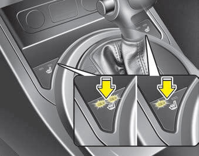
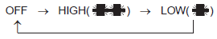
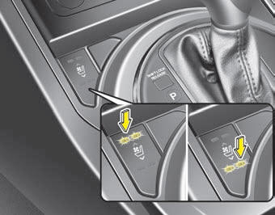
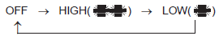

# Kia Sportage: Quaseiraira de assento

[Home](../../index.md) / [Manual do proprietário do Kia Sportage SL](../sportage-1236.md) / [Recursos de segurança do seu veículo](sportage-1249.md) / [Assentos](sportage-1250.md) / Quaseiraira de assento

**Tipo A**

A quaseiraira de assento é fornecida para aquecer os assentos dianteiros em dias frios. Com o interruptor de ignição na posição ON, pressione qualquer um dos interruptores para aquecer o assento do motorista ou o assento do passageiro dianteiro.

Em dias de clima suave ou quando a operação da quaseiraira de assento não for necessária, mantenha os interruptores na posição OFF.

- Cada vez que você pressionar o botão, a configuração de temperatura do assento mudará conforme segue:

- A quaseiraira de assento (OFF) será ativada automaticamente sempre que o interruptor de ignição for ligado.

*✽ NOTA*

*Com o interruptor de quaseiraira de assento na posição ON, o sistema de aquecimento do assento ligará ou desligará automaticamente dependendo da temperatura do assento.*

**Tipo B (com ventilação de ar, se equipado)**

A configuração de temperatura do assento muda conforme a posição do interruptor.

- Se quiser aquecer a almofada do assento, pressione a parte frontal do interruptor (cor amarela).
- Se quiser resfriar a almofada do assento, pressione a parte traseira do interruptor (cor azul).
- Cada vez que você pressionar o botão, a configuração de temperatura ou fluxo de ar mudará conforme segue:

- A quaseiraira de assento (com ventilação de ar) será ativada automaticamente sempre que o interruptor de ignição for ligado.

CAUTION - Danos ao assento

- *Ao limpar os assentos, não use solventes orgânicos como tinta, benzeno, álcool e gasolina. Isso pode danificar a superfície da quaseiraira ou dos assentos.*
- *Para evitar o aquecimento excessivo da quaseiraira de assento, não coloque nada nos assentos que isole o calor, como cobertores, almofadas ou tapetes de assento enquanto a quaseiraira estiver em operação.*
- *Não coloque objetos pesados ou afiados nos assentos equipados com aquecedores de assento. Danos aos componentes de aquecimento do assento podem ocorrer.*

WARNING - Queimaduras da quaseiraira de assento

*A quaseiraira de assento pode causar queimaduras, mesmo a baixas temperaturas, se usado por um período prolongado. Nunca permita que passageiros que não possam cuidar de si mesmos sejam expostos ao risco de queimaduras da quaseiraira. Isso inclui:*

*1. Bebês, crianças, idosos ou pessoas com deficiência, ou pacientes ambulatoriais

2. Pessoas com pele sensível ou que queimam facilmente

3. Pessoas cansadas

4. Pessoas embriagadas

5. Pessoas que estão tomando medicamentos que podem causar sonolência ou letargia (pílulas para dormir, remédios para resfriado, etc.)*

- [Pochete do assento](sportage-1262.md)
