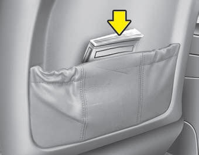

# Kia Sportage: Bolsa de traseiro do assento

[Home](../../index.md) / [Manual do proprietário do Kia Sportage SL](../sportage-1236.md) / [Recursos de segurança do seu veículo](sportage-1249.md) / [Assentos](sportage-1250.md) / [Aquecedor do assento frontal](sportage-1261.md) / Bolsa de traseiro do assento

AVISO - Bolsa de traseiro do assento

*Não coloque objetos pesados ou afiados na bolsa de traseiro do assento. Um ocupante poderia entrar em contato com tais objetos em um impacto. Objetos pesados na bolsa de traseiro do passageiro frontal também poderiam interferir no sistema de detecção do air bag.*

Para o funcionamento adequado do Sistema de Detecção de Ocupaantes (SDO):

- Não coloque nenhum item com peso acumulado superior a 1 kg (2,2 lbs) na bolsa de traseiro do assento ou no assento do passageiro frontal.
- Não pendure roupas ou outros objetos no assento do passageiro frontal.
