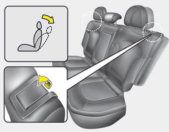

# Kia Sportage: Ajuste do assento traseiro

[Home](../../index.md) / [Manual do proprietário do Kia Sportage SL](../sportage-1236.md) / [Recursos de segurança do seu veículo](sportage-1249.md) / [Assentos](sportage-1250.md) / Ajuste do assento traseiro

**Ângulo do encosto do assento**

Para inclinar o encosto do assento:

1. Empurre para cima o gancho do encosto do assento.

2. Mantenha o gancho e ajuste o encosto do assento para a posição desejada.

3. Solte o gancho e verifique se o encosto do assento está bloqueado na posição desejada. (O gancho DEVE retornar à sua posição original para que o encosto do assento seja bloqueado.)

- [Plegando o assento traseiro](sportage-1264.md)
- [Cabeçote](sportage-1265.md)
- [Braço do assento traseiro](sportage-1266.md)
- [Aquecedor do assento traseiro](sportage-1267.md)
