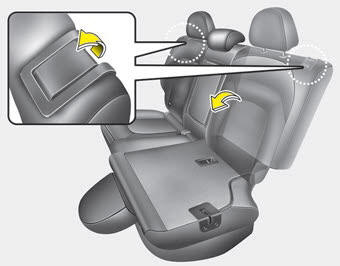
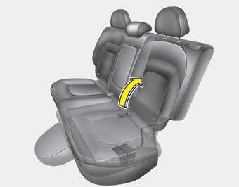

# Kia Sportage: Dobrando o banco traseiro

[Home](../../index.md) / [Manual do proprietário do Kia Sportage SL](../sportage-1236.md) / [Recursos de segurança do seu veículo](sportage-1249.md) / [Bancos](sportage-1250.md) / [Ajuste do banco traseiro](sportage-1263.md) / Dobrando o banco traseiro

Os bancos traseiros podem ser dobrados para facilitar o transporte de itens longos ou para aumentar a capacidade de bagagem do veículo.

AVISO

*Nunca permita que passageiros se sentem sobre o banco traseiro dobrado enquanto o veículo estiver em movimento. Este não é um posicionamento adequado para assentos e não há cintos de segurança disponíveis para uso. Isso pode resultar em ferimentos graves ou morte em caso de acidente ou freio brusco.*

AVISO - Objetos

*Objetos transportados sobre o banco traseiro dobrado não devem ultrapassar a altura dos bancos dianteiros. Isso pode permitir que o carregamento se desloque para frente e cause ferimentos ou danos durante freios bruscos.*

1. Insira o gancho do cinto de segurança traseiro na bolsa (se equipado) entre o banco traseiro e o assento, e insira a fita do cinto de segurança na guia para prevenir o dano ao cinto de segurança.

2. Coloque o banco dianteiro em posição ereta e, se necessário, desloque o banco dianteiro para frente.

3. Baixe os respingos de cabeça traseiros para a posição mais baixa.

4. Puxe o gancho de dobragem do banco traseiro, depois dobre o banco para frente do veículo.

5. Quando retornar o banco traseiro à posição ereta, sempre verifique se ele está completamente bloqueado na posição ereta pressionando o topo do banco traseiro. Em caso de acidente ou freio brusco, o banco traseiro não bloqueado pode permitir que o carregamento se mova com grande força e entre no compartimento de passageiros.

Ao retornar os bancos traseiros à posição ereta, lembre-se de retornar os cintos de segurança do ombro traseiros à posição correta. Roteie a fita do cinto de segurança através das guias do cinto de segurança traseiro para ajudar a evitar que os cintos sejam presos atrás ou sob os bancos.

CAUTION - Danos aos ganchos do cinto de segurança traseiro

*Quando você dobrar o banco traseiro, insira o gancho na bolsa entre o banco traseiro e o assento. Isso pode prevenir danos ao gancho pelo banco traseiro.*

AVISO - Carregamento

*Não coloque objetos pesados nos bancos traseiros, pois eles não podem ser segurados adequadamente e podem bater nos ocupantes do veículo em um acidente frontal.*

Certifique-se de que o motor esteja desligado, a transmissão automática esteja em P (Park) ou a transmissão manual esteja em 1º, e o freio de estacionamento esteja firmemente aplicado sempre que carregar.

ou desembarcar carga. Falta de esses passos pode permitir que o veículo se mova se
a alavanca de engrenagem for acidentalmente movida para outra posição.
