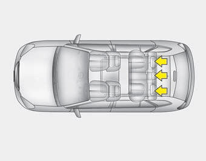
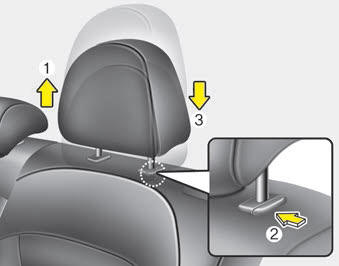
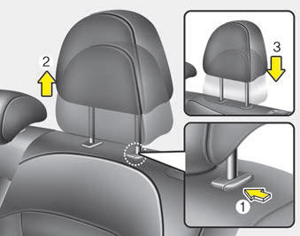

# Kia Sportage: Travesseiro

[Home](../../index.md) / [Manual do proprietário Kia Sportage SL](../sportage-1236.md) / [Recursos de segurança do seu veículo](sportage-1249.md) / [Assentos](sportage-1250.md) / [Ajuste do assento traseiro](sportage-1263.md) / Travesseiro

O assento traseiro está equipado com travesseiros em todas as posições de
assentos para a segurança e conforto dos ocupantes.

O travesseiro não oferece apenas conforto aos passageiros, mas também ajuda a proteger
a cabeça e o pescoço em caso de colisão.

- Para maior eficácia em caso de acidente, o travesseiro do assento traseiro
	deve ser ajustado de modo que o centro do travesseiro esteja na mesma altura
	que o centro de gravidade da cabeça do ocupante. Geralmente, o centro de gravidade
	da cabeça de mais pessoas está no nível da altura dos olhos.
- Ajuste também o travesseiro o mais próximo possível da sua cabeça. Por isso,
	o uso de um travesseiro que mantém o corpo afastado da encosto do assento não é recomendado.

**Ajustando a altura**

Para levantar o travesseiro, pressione e segure o botão de liberação (1) enquanto o puxa
até a posição desejada (2). Para abaixar o travesseiro, pressione e segure o botão de liberação
(1) na base do travesseiro e abaixe o travesseiro até a posição desejada (3).

**Remoção e reinstalação**

Para remover o travesseiro, levante-o o máximo possível, depois pressione o botão de liberação
(1) enquanto puxa o travesseiro (2).

Para reinstalar o travesseiro, coloque as barras do travesseiro (3) nos orifícios enquanto pressiona
o botão de liberação (1). Em seguida, ajuste-o à altura apropriada.
