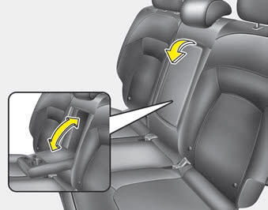

# Kia Sportage: Bancada traseira

[Início](../../index.md) / [Manual do proprietário Kia Sportage SL](../sportage-1236.md) / [Recursos de segurança do seu veículo](sportage-1249.md) / [Bancos](sportage-1250.md) / [Ajuste dos bancos traseiros](sportage-1263.md) / Bancada traseira

Para usar a bancada, puxe-a para frente da parte traseira do encosto do banco.
