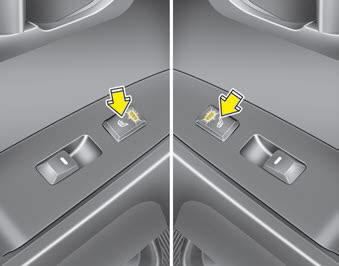

# Kia Sportage: Aquecedor de assentos traseiros

[Home](../../index.md) / [Manual do proprietário do Kia Sportage SL](../sportage-1236.md) / [Recursos de segurança do seu veículo](sportage-1249.md) / [Assentos](sportage-1250.md) / [Ajuste dos assentos traseiros](sportage-1263.md) / Aquecedor de assentos traseiros

O aquecedor de assento é fornecido para aquecer os assentos traseiros em dias frios. Com o interruptor de ignição na posição ON, pressione qualquer um dos interruptores para aquecer os assentos traseiros.

Em dias de clima suave ou quando a operação do aquecedor de assento não for necessária, mantenha os interruptores na posição "OFF".

*NOTA*

*Com o interruptor de aquecedor de assento na posição ON, o sistema de aquecimento do assento ligará ou desligará automaticamente dependendo da temperatura do assento.*

CAUTION

- *Ao limpar os assentos, não use solventes orgânicos como tinta, benzeno, álcool e gasolina. Isso pode danificar a superfície do aquecedor ou dos assentos.*
- *Para prevenir o aquecimento excessivo do aquecedor de assento, não coloque nada nos assentos que isole contra o calor, como cobertores, almofadas ou tapetes de assento enquanto o aquecedor de assento estiver em operação.*
- *Não coloque objetos pesados ou afiados nos assentos equipados com aquecedores de assento. Pode ocorrer danos aos componentes de aquecimento dos assentos.*

WARNING - Queimaduras do aquecedor de assento

*Os passageiros devem usar extrema cautela ao usar os aquecedores de assento devido à possibilidade de aquecimento excessivo ou queimaduras. O aquecedor de assento pode causar queimaduras mesmo em temperaturas baixas, especialmente se usado por períodos prolongados. Em particular, o condutor deve exercer extrema cautela para os seguintes tipos de passageiros:*

*1. Bebês, crianças, idosos ou pessoas com deficiência, ou pacientes ambulatoriais

2. Pessoas com pele sensível ou que queimam facilmente

3. Indivíduos cansados

4. Indivíduos embriagados

5. Indivíduos que estão tomando medicamentos que podem causar sonolência ou letargia (pílulas para dormir, comprimidos para resfriado, etc.)*
