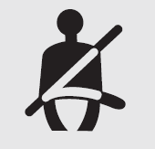

# Kia Sportage: Aviso do cinto de segurança (para o assento do motorista)

[Home](../../index.md) / [Manual do proprietário Kia Sportage SL](../sportage-1236.md) / [Recursos de segurança do seu veículo](sportage-1249.md) / [Cintos de segurança](sportage-1268.md) / [Sistema de retenção do cinto de segurança](sportage-1269.md) / Aviso do cinto de segurança (para o assento do motorista)

Como lembrete ao motorista, a luz do cinto de segurança vai piscar aproximadamente
6 segundos a cada vez que você ligar o chave de ignição, independentemente da fixação do cinto.

Se o cinto de segurança do assento do motorista não estiver fixado quando a chave de ignição for ligada,
a luz do cinto de segurança e o zumbido do cinto de segurança vão funcionar por aproximadamente 6 segundos.
Mas se ele for fixado dentro dos 6 segundos, a luz vai piscar até o fim dos 6 segundos. O zumbido vai se desligar imediatamente.

Se o cinto de segurança do assento do motorista for desconectado após a chave de ignição ser ligada,
a luz do cinto de segurança e o zumbido vão funcionar por aproximadamente 6 segundos.
Mas se ele for fixado dentro dos 6 segundos, a luz e o zumbido vão se desligar imediatamente.
Se o cinto de segurança do assento do motorista não estiver fixado quando a velocidade do veículo
exceder 10 km/h (6 mph), a luz do cinto de segurança e o zumbido vão funcionar aproximadamente
11 vezes com um padrão de 6 segundos ligados e 24 segundos desligados até
o cinto ser fixado ou a velocidade do veículo diminuir abaixo de 5 km/h (3 mph).
