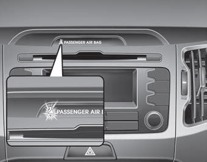

# Kia Sportage: Aviso do cinto de segurança (para o assento do passageiro)

[Home](../../index.md) / [Manual do proprietário do Kia Sportage SL](../sportage-1236.md) / [Recursos de segurança do seu veículo](sportage-1249.md) / [Cintos de segurança](sportage-1268.md) / [Sistema de retenção do cinto de segurança](sportage-1269.md) / Aviso do cinto de segurança (para o assento do passageiro)

Como uma lembrança ao passageiro do banco frontal, a luz de advertência do cinto de segurança do passageiro piscará aproximadamente 6 segundos a cada vez que você ligar o interruptor de ignição, independentemente da fixação do cinto. Se o cinto de segurança do passageiro estiver desafivelado e a velocidade do veículo ultrapassar 10 km/h (6 mph), a luz de advertência do cinto de segurança piscará por pelo menos 6 segundos até que o cinto seja aferivelado.
