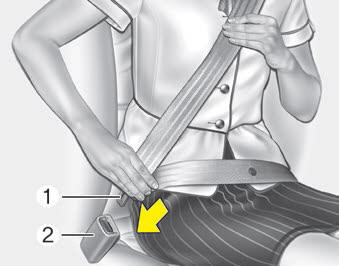
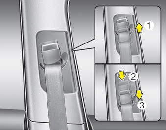
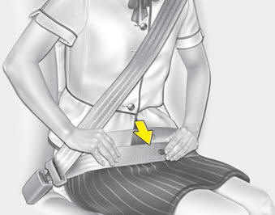

# Kia Sportage: Cinto de segurança - Sistema 3-pontas do motorista com retractor de emergência

[Início](../../index.md) / [Manual do proprietário Kia Sportage SL](../sportage-1236.md) / [Recursos de segurança do seu veículo](sportage-1249.md) / [Cintos de segurança](sportage-1268.md) / [Sistema de retenção de cinto de segurança](sportage-1269.md) / Cinto de segurança - Sistema 3-pontas do motorista com retractor de emergência

Para amarrar o cinto de segurança:

Para amarrar o cinto de segurança, tire-o do retractor e insira a aba metálica (1) no engate (2). Haverá um clique audível quando a aba se engatar no engate.

O cinto de segurança ajusta automaticamente a sua comprimento apenas após ajustar manualmente a parte do cinto de cintura para que ele se ajuste confortavelmente ao seu quadril. Se você se inclinar para frente em um movimento lento e fácil, o cinto irá esticar e permitir que você se mova. No entanto, se houver um freio brusco ou impacto, o cinto irá se engastar. Ele também se engastará se você tentar se inclinar para frente rapidamente.

Se você não puder tirar o cinto de segurança do retractor, tire-o firmemente e solte-o. Então você poderá tirar o cinto de forma suave.

**Ajuste de altura**

Você pode ajustar a altura do anel do cinto de ombro para uma das 4 posições para maior conforto e segurança.

A altura do anel do cinto de ombro não deve estar muito próxima ao seu pescoço. O cinto de ombro deve ser ajustado para que ele fique sobre o seu peito e no meio do seu ombro, perto da porta e não no seu pescoço.

Para ajustar a altura do anel do cinto de ombro, abaixe ou levante o ajustador de altura para a posição apropriada.

Para levantar o ajustador de altura, puxe-o para cima (1). Para abaixá-lo, empurre-o para baixo (3) enquanto pressionar o botão do ajustador de altura (2).

Solte o botão para engastar o anel em posição. Tente deslizar o ajustador de altura para garantir que ele tenha se engastado.

AVISO - Posicionamento do cinto de ombro

*Nunca posicione o cinto de ombro sobre o seu pescoço ou rosto.*

AVISO - Troca do cinto de segurança

*Substitua os cintos de segurança após um acidente. Falhar em substituir os cintos de segurança após um acidente pode deixá-lo com cintos de segurança danificados que não fornecerão proteção em caso de colisão.*

Você deve colocar a parte do cinto de cintura tão baixa quanto possível e ajustada ao seu quadril. Se o cinto de cintura estiver localizado muito alto na sua cintura, pode aumentar a chance de lesão em caso de colisão.

O braço mais próximo ao engate do cinto de segurança deve estar sobre o cinto, enquanto o outro braço deve estar sob o cinto, conforme mostrado na ilustração.
