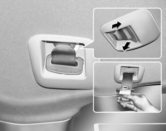
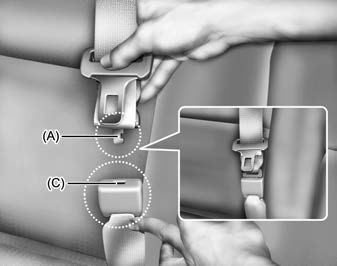
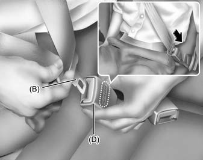

# Kia Sportage: Cinto de 3 Pontos do Centro Traseiro

[Home](../../index.md) / [Manual do Proprietário do Kia Sportage SL](../sportage-1236.md) / [Características de segurança do seu veículo](sportage-1249.md) / [Cintos de segurança](sportage-1268.md) / [Sistema de retenção de cinto de segurança](sportage-1269.md) / Cinto de 3 Pontos do Centro Traseiro

Para amarrar o cinto de 3 pontos do centro traseiro

1. Extraia a placa do gancho (tongue plate) do orifício na capa do conjunto do cinto e, lentamente, puxe as placas do gancho (tongue plates) do retenedor.

2. Insira a placa do gancho (A) no final aberto do gancho (C) até ouvir um “click” audível, indicando que o gancho está trancado. Certifique-se de que o cinto não esteja torcido.

3. Puxe o tecido do cinto e insira a placa do gancho (B) no final aberto do gancho (D) até ouvir um “click” audível, indicando que o gancho está trancado. Certifique-se de que o cinto não esteja torcido.

Ao usar o cinto de 3 pontos do centro traseiro, deve-se usar o gancho com a marca “CENTER”.

Haverá um “click” audível quando a aba se trancar no gancho. O cinto de segurança se ajustará automaticamente à comprimento correto apenas após o cinto de cintura ser ajustado manualmente para se ajustar confortavelmente ao seu quadril. Se você se inclinar para frente em um movimento lento e fácil, o cinto se estenderá e permitirá que você se mova. Se ocorrer uma parada súbita ou impacto, o cinto se trancará em posição. Também se trancará se você tentar se inclinar para frente rapidamente.

Ao usar o cinto de segurança do centro traseiro, é necessário trancar todas as placas do gancho e os ganhos.
