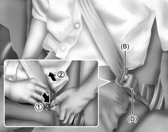
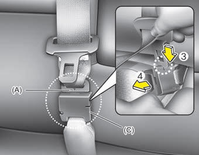
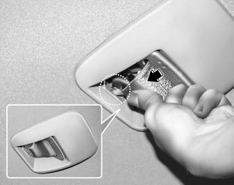
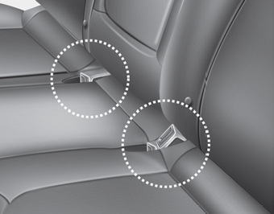

# Kia Sportage: Para desengatar o cinto traseiro central

[Início](../../index.md) / [Manual do proprietário do Kia Sportage SL](../sportage-1236.md) / [Recursos de segurança do seu veículo](sportage-1249.md) / [Cintos de segurança](sportage-1268.md) / [Sistema de retenção de cinto de segurança](sportage-1269.md) / Para desengatar o cinto traseiro central

1. Pressione o botão de liberação na engrenagem (D) e remova a placa da língua (B) da engrenagem (D).

2. Para retração do cinto traseiro central, insira a placa da língua ou um pequeno dispositivo rígido similar na fenda de liberação da web (C). Puxe para cima a web do cinto (A) e permita que a webbing se retrai automaticamente.

3. Insira a placa da língua na fenda na capa do conjunto do cinto.

