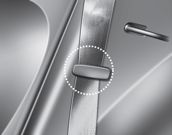

# Kia Sportage: Armazenando o cinto de segurança traseiro

[Home](../../index.md) / [Manual do proprietário do Kia Sportage SL](../sportage-1236.md) / [Recursos de segurança do seu veículo](sportage-1249.md) / [Cintos de segurança](sportage-1268.md) / [Sistema de retenção de cinto de segurança](sportage-1269.md) / Armazenando o cinto de segurança traseiro

Os mecanismos de cinto de segurança do banco traseiro podem ser armazenados na
pasta entre o encosto e o assento quando não estiverem em uso.

Dirigir o tecido do cinto de segurança através dos guias do cinto de segurança traseiro
ajudará a evitar que os cintos fiquem presos atrás ou sob os bancos.

Após inserir o cinto de segurança, apertar o tecido do cinto de segurança
puxando-o para cima.

ATENÇÃO - Guia do cinto de segurança

*Remova o cinto de segurança dos guias antes de usar. Se você puxar o cinto de segurança
quando ele estiver armazenado nos guias, pode danificar os guias e/ou o tecido do cinto de segurança.*
