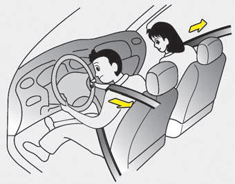
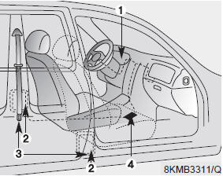

# Kia Sportage: Pre-tensador do cinto de segurança

[Home](../../index.md) / [Manual do proprietário do Kia Sportage SL](../sportage-1236.md) / [Recursos de segurança do seu veículo](sportage-1249.md) / [Cintos de segurança](sportage-1268.md) / Pre-tensador do cinto de segurança

Seu veículo está equipado com cinto de segurança pre-tensador para o condutor e passageiro frontal. O objetivo do pre-tensador é garantir que o cinto de segurança fique apertado contra o corpo do ocupante em certos choques frontais (ou laterais ou rolamentos). Os cintos de segurança pre-tensador podem ser ativados em certos choques frontais e impactos laterais e rolamentos, onde o choque frontal (ou laterais ou rolamentos) é severo o suficiente, junto com os air bags.

Quando o veículo para de forma repentina, ou se o ocupante tentar se inclinar para frente rapidamente, o retenedor do cinto de segurança bloqueará na posição. Em certos choques frontais (ou laterais ou rolamentos), o pre-tensador será ativado e puxará o cinto de segurança para um contato mais apertado contra o corpo do ocupante.

Se o sistema detectar tensão excessiva no cinto de segurança do condutor ou passageiro quando o pre-tensador for ativado, o limite de carga dentro do pre-tensador liberará parte da pressão sobre o cinto de segurança afetado.

*NOTA*

*O pre-tensador será ativado não apenas em choques frontais, mas também em choques laterais ou rolamentos, se o veículo estiver equipado com air bag lateral ou cortina.*

O sistema de pre-tensador do cinto de segurança consiste principalmente nos seguintes componentes. Suas localizações são mostradas na ilustração:

1. Luz de advertência do air bag do SRS

2. Conjunto de retenção e pre-tensador

3. Pre-tensador de ancoragem frontal

4. Módulo de controle do SRS

Ambos os cintos de segurança pre-tensador para o condutor e passageiro frontal podem ser ativados em certos choques.

O pre-tensador não será ativado se os cintos de segurança não estiverem sendo usados no momento do choque.

*NOTA*

*Quando os cintos de segurança pre-tensador são ativados, pode-se ouvir um barulho alto e uma fina poeira, que pode parecer fumaça, pode ser visível no compartimento do passageiro. Essas são condições normais de operação e não são perigosas.*

AVISO - Irritação cutânea

*Lave todas as áreas de pele exposta com água abundante após um acidente em que os cintos de segurança pre-tensador foram ativados. A fina poeira do pre-tensador de ativação pode causar irritação cutânea e não deve ser inalada por períodos prolongados.*

Como o sensor que ativa o air bag do SRS está conectado com o pre-tensador do cinto de segurança, a luz de advertência do air bag do SRS (!

)
no painel de instrumentos ficará acesa por aproximadamente 6 segundos após o interruptor de ignição ter sido colocado na posição ON, e então deve se apagar.

Se o pre-tensador do cinto de segurança não estiver funcionando corretamente, esta luz de advertência ficará acendida.

illumine mesmo se não houver falha no air bag do SRS. Se a luz de advertência do air bag do SRS não illumina quando o interruptor de ignição é ligado, ou se permanece illumina após illuminar por aproximadamente 6 segundos, ou se illumina enquanto o veículo estiver em movimento, por favor, leve o veículo a um concessionário autorizado da Kia o mais rápido possível para inspeção do pre-tensador do cinto de segurança e do sistema de air bag do SRS.

AVISO - Pre-tensador quente

*não toque nas montagens de cinto de segurança pre-tensador por vários minutos após sua ativação. Quando o mecanismo de pre-tensador do cinto de segurança disparar em um acidente, o pre-tensador esquenta e pode queimar.*

Os pre-tensadores são projetados para operar apenas uma vez. Após a ativação, os cintos de segurança pre-tensador devem ser substituídos. Se o pre-tensador precisar ser substituído, entre em contato com um concessionário autorizado da Kia.
