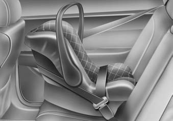
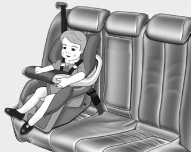

# Kia Sportage: Usando um sistema de retenção infantil

[Home](../../index.md) / [Manual do proprietário Kia Sportage SL](../sportage-1236.md) / [Recursos de segurança do seu veículo](sportage-1249.md) / [Sistema de retenção infantil](sportage-1286.md) / Usando um sistema de retenção infantil

Sistema de retenção infantil voltado para trás

Sistema de retenção infantil voltado para frente

Para crianças pequenas e bebês, o uso de um assento infantil ou assento para bebê é necessário.

O assento infantil ou assento para bebê deve ser do tamanho apropriado para a criança e deve ser instalado de acordo com as instruções do fabricante.

Devido à segurança, recomendamos que o sistema de retenção infantil seja usado nas cadeiras traseiras.

Nunca coloque um assento infantil voltado para trás no assento do passageiro frontal, pois há o perigo de um airbag do passageiro inflar e impactar o assento infantil voltado para trás, matando a criança.

Como os cintos de segurança dos assentos passageiros se movem livremente em condições normais e só se travam em condições extremas ou de emergência (modo de travamento automático), você deve mudar manualmente esses cintos de segurança para o modo de travamento automático para reter um sistema de retenção infantil.

Se o cinto de segurança não funcionar conforme descrito nesta seção, tenha o sistema verificado imediatamente em seu concessionário autorizado Kia.

AVISO - Instalação de assento infantil

- *Sempre siga as instruções fornecidas pelo fabricante do sistema de retenção infantil. Os fabricantes de sistemas de retenção infantil conhecem seus produtos melhor.*
- *Falhar em observar as instruções deste manual sobre sistema de retenção infantil e as instruções fornecidas com o sistema de retenção infantil pode resultar na instalação incorreta do sistema de retenção infantil, o que pode reduzir a proteção para a criança em um acidente ou parada súbita.*

*✽ NOTA*

*Se a estrutura de apoio-cabeça do veículo impedir a instalação correta de um assento infantil, a estrutura de apoio-cabeça da respectiva posição de assento deve ser ajustada ou removida completamente.*

- [Colocando um cinto de segurança do passageiro no modo de travamento automático](sportage-1288.md)
- [Segurando um assento de retenção infantil com ancoragem de cinto](sportage-1289.md)
- [Segurando um assento de retenção infantil com ancoragem inferior de assento infantil](sportage-1290.md)
