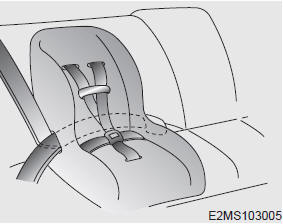
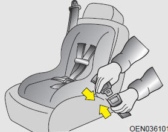
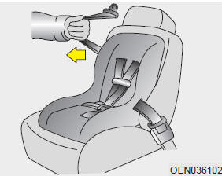
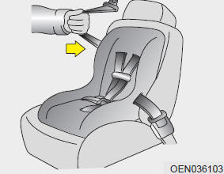
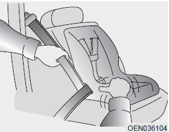

# Kia Sportage: Colocando um cinto de segurança do passageiro no modo automático de bloqueio

[Home](../../index.md) / [Manual do proprietário do Kia Sportage SL](../sportage-1236.md) / [Recursos de segurança do seu veículo](sportage-1249.md) / [Sistema de retenção infantil](sportage-1286.md) / [Usando um sistema de retenção infantil](sportage-1287.md) / Colocando um cinto de segurança do passageiro no modo automático de bloqueio

O modo automático de bloqueio ajudará a prevenir o movimento normal da criança no veículo de causar o cinto de segurança se soltar e comprometer o sistema de retenção infantil. Para fixar um sistema de retenção infantil, siga o procedimento a seguir.

Para instalar um sistema de retenção infantil nas poltronas laterais ou centrais traseiras, faça o seguinte:

1. Coloque o sistema de retenção infantil na poltrona e guie o cinto de segurança de cintura/ombro ao redor ou através do sistema de retenção, seguindo as instruções do fabricante do sistema de retenção. Certifique-se de que a web do cinto de segurança não esteja torcida.

2. Feche o gancho do cinto de segurança/ombro na alça. Ouça o som distintivo de “click”.

Posicione o botão de liberação de forma que seja fácil de acessar em caso de emergência.

3. Puxe toda a parte do cinto de ombro para fora. Quando a parte do cinto de ombro estiver totalmente estendida, ela fará com que o retractor se mova para o modo “Auto Lock” (retenção infantil).

4. Permita que a parte do cinto de ombro se retraia lentamente e ouça um som audível de “click” ou “rachet”. Isso indica que o retractor está no modo “Auto Lock”. Se não ouvir um som distintivo, repita os passos 3 e 4.

5. Remova o máximo possível de frouxidão do cinto empurrando para baixo no sistema de retenção infantil enquanto alimenta o cinto de ombro de volta no retractor.

6. Empurre e puxe o sistema de retenção infantil para confirmar que o cinto de segurança está segurando firmemente. Se não estiver, libere o cinto e repita os passos 2 a 6.

7. Verifique novamente se o retractor está no modo “Auto Lock” tentando puxar mais do cinto de segurança do retractor. Se não conseguir, o retractor está no modo “Auto Lock”.

O cinto de segurança de cintura/ombro retorna automaticamente ao modo “lock de emergência” sempre que o cinto for permitido a se retrair completamente. Portanto, os sete passos anteriores devem ser seguidos toda vez que um sistema de retenção infantil for instalado.

Para remover o sistema de retenção infantil, pressione o botão de liberação na alça e, em seguida, retire o cinto de segurança/ombro do sistema de retenção e permita que o cinto de segurança se retraiu completamente.

AVISO - Modo automático de bloqueio

*Configure o retractor para o modo de bloqueio automático ao instalar qualquer sistema de retenção infantil.*

*Se o retractor não estiver no modo de bloqueio automático, o sistema de retenção infantil pode se mover quando o seu veículo virar ou parar de forma repentina.*

Quando o cinto de segurança é permitido a se retrair para sua posição totalmente estocada, o retractor

vai automaticamente trocar do modo “Auto Lock” para o modo de travamento de emergência para
uso normal de adultos.
