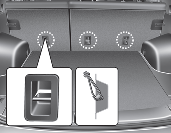
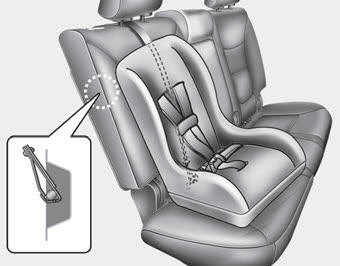

# Kia Sportage: Fixando um assento de retenção infantil com sistema de anclagem por arreia

[Home](../../index.md) / [Manual do proprietário do Kia Sportage SL](../sportage-1236.md) / [Recursos de segurança do seu veículo](sportage-1249.md) / [Sistema de retenção infantil](sportage-1286.md) / [Usando um sistema de retenção infantil](sportage-1287.md) / Fixando um assento de retenção infantil com sistema de anclagem por arreia

Os suportes de arreia para assento de retenção infantil estão localizados na parte de trás dos encostos das cadeiras traseiras.

1. Faça passar a arreia do assento de retenção infantil pelo encosto da cadeira.

Para veículos com headrests ajustáveis, faça passar a arreia do anel de segurança sob o headrest e entre as colunas do headrest. Caso contrário, faça passar a arreia do anel de segurança pelo topo do encosto da cadeira. Em caso de interferência entre o assento de retenção infantil e o headrest, remova o headrest particular para melhor ajuste do assento de retenção infantil.

2. Conecte o gancho da arreia do anel de segurança ao suporte apropriado de arreia do assento de retenção infantil e aperte para fixar o assento de retenção infantil.

AVISO - Arreia do anel de segurança

*Nunca monte mais de um assento de retenção infantil em uma única arreia ou em um único ponto de anclagem inferior. O aumento da carga causado por assentos adicionais pode causar a quebra das arreias ou pontos de anclagem.*

Verifique a fixação do sistema de retenção infantil empurrando e puxando-o em diferentes direções. Assentos de retenção infantil mal ajustados podem balançar, girar, inclinar-se ou se separar, causando morte ou ferimentos graves.
