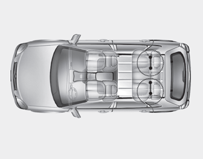
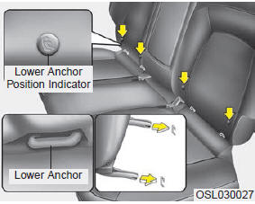
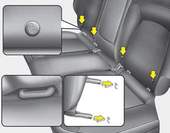

# Kia Sportage: Fixando um assento de retenção infantil com o sistema de anéis de retenção inferior LATCH

[Início](../../index.md) / [Manual do proprietário do Kia Sportage SL](../sportage-1236.md) / [Recursos de segurança do seu veículo](sportage-1249.md) / [Sistema de retenção infantil](sportage-1286.md) / [Usando um sistema de retenção infantil](sportage-1287.md) / Fixando um assento de retenção infantil com o sistema de anéis de retenção inferior LATCH

Alguns fabricantes de assentos para crianças produzem assentos de retenção infantil rotulados como
LATCH ou compatíveis com o sistema LATCH. LATCH significa "Anchors e Tethers for Children". Esses assentos incluem duas conexões rígidas ou de fita que se conectam a dois anéis de retenção LATCH em posições específicas de assentos no seu veículo.
Este tipo de assento de retenção infantil elimina a necessidade de usar cintos de segurança para fixar o assento na parte de trás do veículo.

Os símbolos de retenção infantil estão localizados nas costas dos assentos laterais da parte de trás para indicar a posição dos anéis de retenção inferior para assentos de retenção infantil.

AVISO - Cintos de segurança dos assentos traseiros não utilizados

*Sempre amarre os cintos de segurança atrás do assento de retenção infantil quando eles não forem utilizados para fixar o assento de criança. Falhar em fazer isso pode resultar em asfixia da criança.*

Os anéis de retenção LATCH foram fornecidos no seu veículo. Os anéis de retenção LATCH estão localizados nas posições de assentos laterais da parte de trás à esquerda e à direita. Seus locais são mostrados na ilustração. Não há anel de retenção LATCH fornecido para a posição central de assentos traseiros.

Os anéis de retenção LATCH estão localizados entre o encosto do assento e a almofada do assento nas posições de assentos laterais da parte de trás à esquerda e à direita.

Siga as instruções do fabricante do assento de retenção infantil para instalar corretamente assentos de retenção infantil com anéis de retenção LATCH ou compatíveis com anéis de retenção LATCH. Uma vez que você tenha instalado o assento de retenção infantil LATCH, assegure-se de que o assento esteja corretamente fixado nos anéis de retenção LATCH e nos anéis de teto.

Também teste o assento de retenção infantil antes de colocar a criança nele. Incline o assento de lado para lado. Tente também puxar o assento para frente. Verifique se os anéis seguram o assento em seu lugar.

AVISO - Anéis de retenção inferior LATCH

*Nunca tente fixar um assento equipado com LATCH na posição central de assentos. Os anéis de retenção inferior LATCH devem ser usados apenas nas posições de assentos laterais da parte de trás à esquerda e à direita. Você pode danificar os anéis ou eles podem falhar e quebrar em um acidente.*
