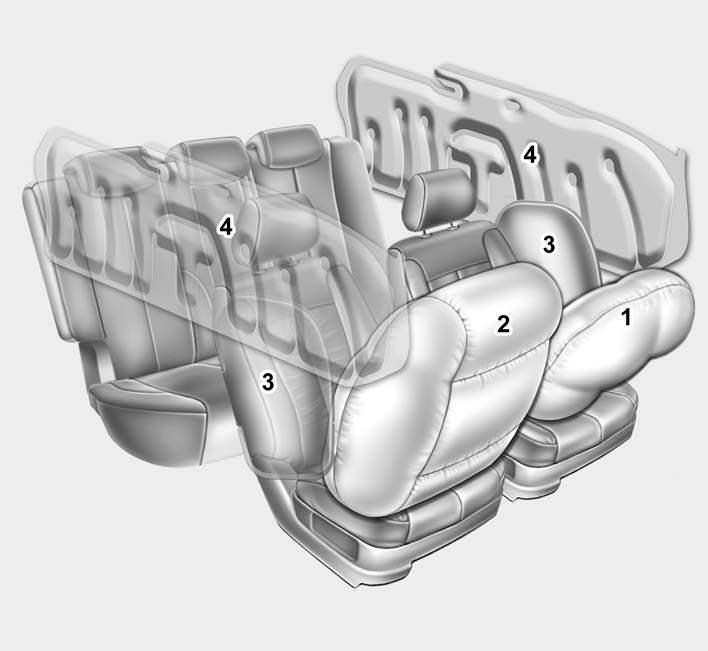

# Kia Sportage: Air bag - sistema de retenção adicional avançado

[Início](../../index.md) / [Manual do proprietário do Kia Sportage SL](../sportage-1236.md) / [Funcionalidades de segurança do seu veículo](sportage-1249.md) / Sistema de air bag - sistema de retenção adicional avançado

(1) Air bag do motorista

(2) Air bag do passageiro

(3) Air bag de impacto lateral

(4) Air bag de cortina

Mesmo em veículos com air bags, você e seus passageiros devem sempre usar os
cinto de segurança fornecidos para minimizar o risco e a gravidade das lesões em
caso de colisão ou rolamento.

- [Como o sistema de air bag opera](sportage-1292.md)
- [Luz de advertência do air bag](sportage-1295.md)
- [Componentes e funções do SRS](sportage-1296.md)
- [Sistema de detecção de ocupantes (SDO)](sportage-1297.md)
- [Air bag do motorista e do passageiro](sportage-1300.md)
- [Air bag de impacto lateral](sportage-1301.md)
- [Air bag de cortina](sportage-1302.md)
- [Cuidados com o SRS](sportage-1306.md)
- [Adicionar equipamentos ou modificar seu veículo equipado com air bags](sportage-1307.md)
- [Rótulo de advertência do air bag](sportage-1308.md)
