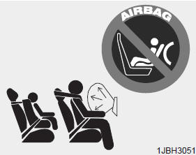

# Kia Sportage: Não instale um dispositivo de retenção infantil no assento do passageiro frontal.

[Início](../../index.md) / [Manual do proprietário Kia Sportage SL](../sportage-1236.md) / [Recursos de segurança do seu veículo](sportage-1249.md) / [Airbag - sistema de retenção adicional de suplemento](sportage-1291.md) / [Como o sistema de airbag opera](sportage-1292.md) / Não instale um dispositivo de retenção infantil no assento do passageiro frontal.

Nunca coloque um dispositivo de retenção infantil voltado para trás no assento do passageiro frontal. Se o airbag depolarizar, ele impactaria o dispositivo de retenção infantil voltado para trás, causando ferimentos graves ou fatais.

Além disso, não coloque dispositivos de retenção infantil voltados para frente no assento do passageiro frontal. Se o airbag do passageiro frontal inflar, poderia causar ferimentos graves ou fatais ao criança.

AVISO - Depolarização do airbag

*Quando crianças estiverem sentadas nos assentos traseiros laterais de um veículo equipado com airbags laterais e/ou cortina, instale o sistema de retenção infantil o mais longe possível da porta. A inflação dos airbags laterais e/ou cortina poderia impactar a criança.*
