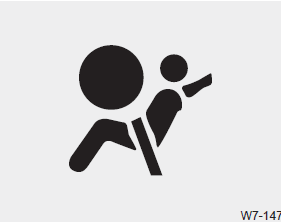

# Kia Sportage: Luz de advertência do air bag

[Home](../../index.md) / [Manual do proprietário do Kia Sportage SL](../sportage-1236.md) / [Recursos de segurança do seu veículo](sportage-1249.md) / [Air bag - sistema de retenção adicional avançado](sportage-1291.md) / Luz de advertência do air bag

O propósito da luz de advertência do air bag no painel do veículo é alertá-lo
sobre um possível problema com o air bag - Sistema de Restrição de Impacto Adicional (SRS).

Quando o interruptor de ignição estiver ligado, a luz deve acender por
aproximadamente 6 segundos, depois apagar.

Tenha o sistema verificado em um concessionário autorizado da Kia se:

- A luz não acender brevemente ao ligar o interruptor de ignição.
- A luz permanece acendida após acender por aproximadamente 6 segundos.
- A luz acende enquanto o veículo estiver em movimento.
- A luz piscar quando o interruptor de ignição estiver na posição ON.
