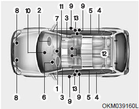
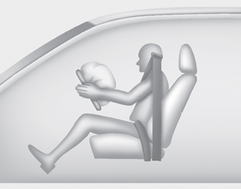
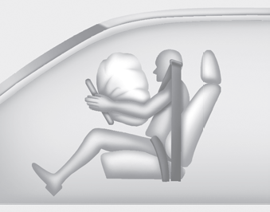
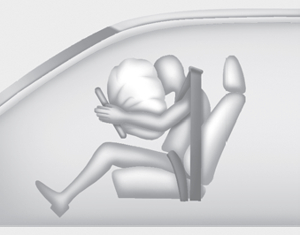
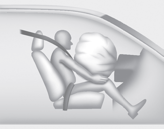

# Kia Sportage: Componentes e funções do SRS

[Home](../../index.md) / [Manual do proprietário do Kia Sportage SL](../sportage-1236.md) / [Recursos de segurança do seu veículo](sportage-1249.md) / [Airbag - sistema de retenção adicional avançado](sportage-1291.md) / Componentes e funções do SRS

O SRS compreende os seguintes componentes:

1. Módulo do airbag do motorista

2. Módulo do airbag do passageiro

3. Módulos do airbag de impacto lateral

4. Módulos do airbag de cortina

5. Montantes pre-tensores

6. Luz de advertência do airbag

7. Módulo de controle do SRS (SRSCM)/ Sensor de rolamento

8. Sensores de impacto frontal

9. Sensores de impacto lateral

10. Indicador "OFF" do airbag do passageiro (somente no assento do passageiro)

11. Sistema de detecção do ocupante (somente no assento do passageiro)

12. Sensores do cinto de segurança do motorista e do passageiro

13. Montante pre-tensor frontal

O SRSCM monitora continuamente todos os componentes do SRS enquanto o interruptor de ignição estiver ligado para determinar se um impacto de colisão é severo o suficiente para exigir a despliegue do airbag ou do pre-tensor do cinto de segurança.

A luz de advertência do airbag na painel de instrumentos ficará acesa por aproximadamente 6 segundos após o interruptor de ignição ser ligado, após o qual a luz de advertência do airbag deve se apagar.

Se qualquer uma das seguintes condições ocorrer, isso indicará um mal funcionamento do SRS. Faça uma inspeção do sistema de airbag em uma concessionária autorizada da Kia o mais rápido possível.

- A luz não acende brevemente ao ligar o interruptor de ignição.
- A luz permanece acesa após acender por aproximadamente 6 segundos.
- A luz acende enquanto o veículo estiver em movimento.
- A luz piscar quando o interruptor de ignição estiver na posição ON.

Airbag do motorista

Os módulos do airbag do motorista estão localizados tanto no centro do volante quanto no painel do passageiro à frente do compartimento do guante. Quando o SRSCM detecta um impacto frontal severo o suficiente, ele automaticamente despliega os airbags do motorista.

Airbag do motorista (2)

Ao despliegar, juntas de separação moldadas diretamente nas coberturas do airbag separam sob a pressão da expansão do airbag. A abertura adicional das coberturas então permite a inflação completa do airbag.

Airbag do motorista (3)

Um airbag completamente inflado, em combinação com um cinto de segurança adequadamente usado, diminui a velocidade do motorista ou do passageiro em movimento, reduzindo o risco de lesões na cabeça e no peito.

Após a inflação completa, o airbag começa imediatamente a defilar, permitindo que o motorista mantenha a visibilidade para frente e a capacidade de manobrar ou operar outros controles.

Airbag do passageiro

AVISO - Obstruções do airbag

*Não instale ou coloque nenhum acessório no volante, painel de instrumentos ou no painel do passageiro à frente do compartimento do guante de um veículo com tais objetos*

pode se tornar um projétil perigoso se o airbag ativar.*

AVISO - Objetos voadores

*não coloque nenhum objeto (um guarda-chuva, bolsa, etc.) entre a porta da frente e o assento do passageiro. Esses objetos podem se tornar projéteis perigosos se o airbag laterais inflar.*

- Se um airbag ativar, pode ocorrer um barulho alto seguido por uma fina poeira liberada no veículo. Essas condições são normais e não tóxicas - os airbags estão embalados nessa fina poeira. A poeira gerada durante a ativação do airbag pode causar irritação na pele ou nos olhos, bem como agravar a asma para algumas pessoas. Lave todas as áreas de pele exposta com água morna e sabão suave após um acidente em que os airbags foram ativados.
- O SRS pode funcionar apenas quando o interruptor de ignição estiver na posição ON. Se a luz do indicador do SRS airbag "" não iluminar, ou permanecer acesa continuamente por cerca de 6 segundos ou piscar quando o interruptor de ignição estiver na posição ON, ou após o motor ser ligado, ou acender durante a condução, o SRS não está funcionando corretamente. Se isso ocorrer, leve seu veículo imediatamente para inspeção em um concessionário autorizado da Kia.

*✽ NOTA*

*antes de substituir um fusível ou desconectar um terminal da bateria, coloque o interruptor de ignição na posição LOCK e remova o interruptor de ignição. Nunca remova ou substitua o(s) fusível(s) relacionado(s) ao airbag quando o interruptor de ignição estiver na posição ON. O não cumprimento desta advertência fará a luz do indicador do SRS airbag acender.*
