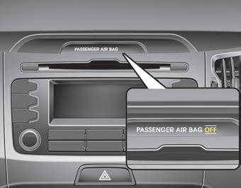

# Kia Sportage: Sistema de Detecção de Ocupaantes (SDO)

[Início](../../index.md) / [Manual do Proprietário do Kia Sportage SL](../sportage-1236.md) / [Recursos de segurança do seu veículo](sportage-1249.md) / [Airbag - sistema de retenção adicional avançado](sportage-1291.md) / Sistema de Detecção de Ocupaantes (SDO)

Seu veículo está equipado com um sistema de detecção de ocupantes na assentada do passageiro frontal.

O sistema de detecção de ocupantes está projetado para detectar a presença de um passageiro frontal corretamente posicionado e determinar se o airbag frontal do passageiro deve ser ativado (pode inflar) ou não. O airbag do motorista não é afetado ou controlado pelo sistema de detecção de ocupantes.

Não coloque nada na frente do airbag do passageiro

- [Componentes principais do sistema de detecção de ocupantes](sportage-1298.md)
- [Condições e operação no sistema de detecção de ocupantes do passageiro frontal](sportage-1299.md)
