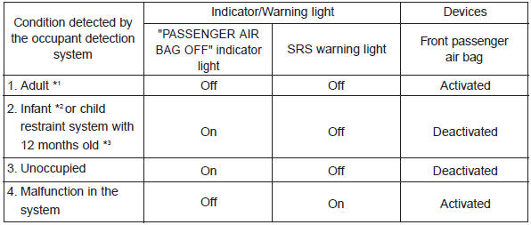
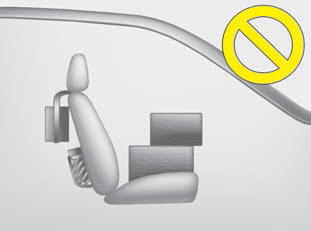
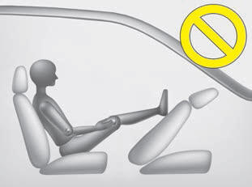
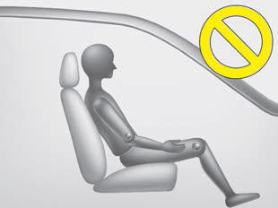
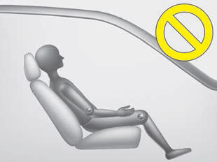
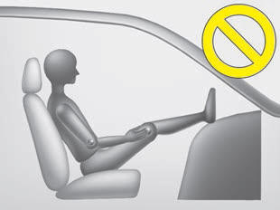
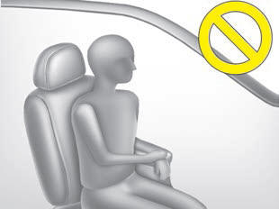
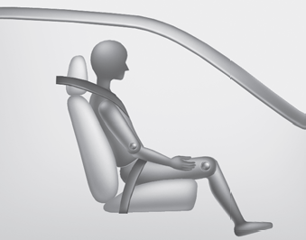

# Kia Sportage: Condições e operação do sistema de detecção de ocupantes do assento do passageiro dianteiro

[Home](../../index.md) / [Manual do proprietário Kia Sportage SL](../sportage-1236.md) / [Recursos de segurança do seu veículo](sportage-1249.md) / [Airbag - Sistema de retenção adicional avançado](sportage-1291.md) / [Sistema de detecção de ocupantes (ODS)](sportage-1297.md) / Condições e operação do sistema de detecção de ocupantes do assento do passageiro dianteiro

*1) O sistema julga uma pessoa adulta. Quando uma pessoa menor adulta se senta no assento do passageiro dianteiro, o sistema pode reconhecê-la como uma criança dependendo de sua constituição física e postura.

*2) Não permita que crianças viajem no assento do passageiro dianteiro. Quando uma criança maior que tenha crescido além do sistema de retenção infantil se sentar no assento do passageiro dianteiro, o sistema pode reconhecê-la como adulta dependendo de sua constituição física ou postura.

*3) Nunca instale um sistema de retenção infantil no assento do passageiro dianteiro.

*AVISO*

*Não modifique ou substitua o assento do passageiro dianteiro. Não coloque nada no assento do passageiro dianteiro ou anexe algo como um cobertor, capa de assento ou aquecedor de assento aftermarket. Isso pode afetar adversamente o sistema de detecção de ocupantes.*

AVISO - Sistema ODS

*Viajar em uma posição inadequada afeta adversamente o sistema de detecção de ocupantes e pode resultar na desativação do airbag do passageiro dianteiro. É importante que o motorista instrua o passageiro sobre as instruções corretas de posicionamento contidas neste manual.*

**

*- Nunca coloque um peso pesado ou um dispositivo eletrônico ativo no assento do passageiro dianteiro ou na bolsa de apoio do assento.*

**

*- Nunca coloque os pés no assento traseiro do passageiro dianteiro.*

**

*- Nunca se sente com os quadris inclinados para a frente do assento.*

**

*- Nunca se incline demais o encosto do assento do passageiro dianteiro.*

**

*- Nunca coloque os pés no painel.*

**

*- Nunca se apoie na porta ou no console central.

- Nunca se sente apenas de um lado do assento do passageiro dianteiro.*

Posição correta

Quando um adulto estiver sentado no assento do passageiro dianteiro, se a indicação do "AIRBAG DO PASSAGEIRO OFF" estiver ligada, vire o interruptor de ignição para a posição LOCK e peça ao passageiro para se sentar corretamente (sentado ereto com o assento em posição ereta, centralizado no assento com o cinto de segurança, pernas estendidas confortavelmente e pés no chão). Reinicie o motor e peça para a pessoa permanecer nessa posição. Isso permitirá que o sistema detecte a pessoa e ative o airbag do passageiro.

Se a indicação "AIRBAG DO PASSAGEIRO OFF" ainda estiver ligada, peça ao passageiro para se mudar para o assento traseiro.

A indicação "AIRBAG DO PASSAGEIRO OFF" não mudará de acordo com a postura dos ocupantes após o veículo ter sido ligado por 30 segundos.

AVISO - “BAGUELA DO PÔS DESLIGADA”

*Não permita que um passageiro adulto viaje no banco do passageiro quando a indicação “OFF” do BAGUELA DO PÔS estiver acesa, pois o airbag não se desplegará em caso de colisão. O condutor deve instruir o passageiro a se readequar na cadeira. Falta de adequação correta pode levar à desativação do airbag, resultando em não desplegamento e em uma colisão. Se a indicação “OFF” do BAGUELA DO PÔS permanecer acesa após o passageiro se readequar corretamente e o carro for reiniciado, é recomendado que o passageiro se mova para o banco traseiro, pois o airbag do passageiro do pôs não se desplegará.*

*✽ NOTA*

*A indicação “OFF” do BAGUELA DO PÔS acende por cerca de 4 segundos após o acionamento do interruptor de ignição na posição ON ou após o acionamento do motor. Se o banco do passageiro do pôs estiver ocupado, o sensor de detecção do ocupante então classificará o passageiro após alguns segundos adicionais.*

Qualquer criança com até 12 anos deve viajar no banco traseiro. Crianças maiores que não podem usar dispositivos de retenção infantil devem usar os cintos de segurança disponíveis. Independentemente do tipo de colisão, crianças de todas as idades são mais seguras quando retenidas no banco traseiro.

Se o sistema de detecção do ocupante não estiver funcionando corretamente, a luz de advertência do SRS airbag

no painel de instrumentos
acenderá, pois o airbag do passageiro do pôs está conectado ao sistema de detecção do ocupante. Se houver um problema com o sistema de detecção do ocupante, a indicação “OFF” do BAGUELA DO PÔS não acenderá e o airbag do passageiro do pôs se inflará em colisões frontais mesmo que não haja ocupante no banco do passageiro do pôs.

AVISO - Troca / modificações

*O banco do passageiro do pôs, painel de instrumentos ou porta não devem ser substituídos, a não ser que sejam feitas por um concessionário autorizado da Kia usando peças originais da Kia projetadas para este veículo e modelo. Qualquer outra substituição ou modificação poderia afetar negativamente a operação do sistema de detecção do ocupante e dos seus airbags avançados.*
