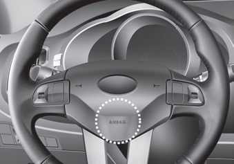
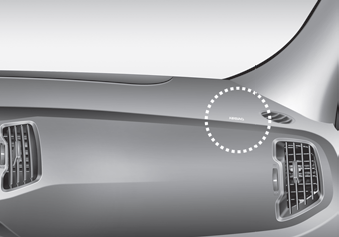
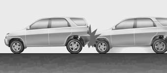
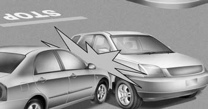
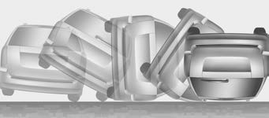

# Kia Sportage: Air bag do motorista e do passageiro

[Home](../../index.md) / [Manual do proprietário do Kia Sportage SL](../sportage-1236.md) / [Recursos de segurança do seu veículo](sportage-1249.md) / [Air bag - sistema de retenção adicional avançado](sportage-1291.md) / Air bag do motorista e do passageiro

Air bag do motorista

Air bag do passageiro

Seu veículo está equipado com um Sistema de Retenção Adicional Avançado (Air Bag) e cinto de segurança de cintura no assento do motorista e do passageiro.

A indicação da presença do sistema é dada pelas letras "AIR BAG" gravadas na capa do air bag no volante e na placa do painel do passageiro acima do compartimento do porta-malas.

O SRS consiste em air bags instalados sob as capas de proteção no centro do volante e no painel do passageiro do lado do passageiro acima do compartimento do porta-malas.

O propósito do SRS é fornecer proteção adicional ao motorista e/ou ao passageiro frontal além daquela oferecida pelo sistema de cinto de segurança em caso de impacto frontal de suficiente severidade. O SRS usa sensores para coletar informações sobre o uso do cinto de segurança do motorista e do passageiro frontal e a severidade do impacto.

CAUTION - Sensor da Trilha do Assento

*Não coloque nenhum objeto sob os assentos dianteiros, pois eles podem danificar o sensor da trilha do assento ou interferir no sistema de detecção de ocupantes.*

Os sensores do cinto de segurança determinam se os cintos de segurança do motorista e do passageiro estão presos.

Esses sensores fornecem a capacidade de controlar a ativação do SRS com base no fato de se os cintos de segurança estão presos e na severidade do impacto.

O SRS avançado oferece a capacidade de controlar a inflação do air bag com dois níveis. Um primeiro nível é fornecido para impactos de severidade moderada. Um segundo nível é fornecido para impactos mais severos.

O air bag do passageiro é projetado para ajudar a reduzir a lesão de crianças sentadas perto do painel de instrumentos em colisões a baixa velocidade. No entanto, as crianças são mais seguras se estiverem retenidas no assento traseiro.

De acordo com a severidade do impacto e o uso do cinto de segurança, o SRSCM (Module de Controle do SRS) controla a inflação do air bag. Falta de uso adequado do cinto de segurança pode aumentar o risco ou a severidade da lesão em caso de acidente.

Adicionalmente, seu veículo está equipado com um sistema de detecção de ocupantes no assento do passageiro dianteiro. O sistema de detecção de ocupantes detecta a presença de um passageiro no assento do passageiro dianteiro e desligará o air bag do passageiro dianteiro sob certas condições. Para mais detalhes, consulte "Sistema de detecção de ocupantes" nesta seção.

WARNING - Modificações

*Modificações na estrutura do assento podem causar o air bag a ser ativado em um nível diferente do que deveria ser fornecido.*

Fabricantes são obrigados, por regulamentos governamentais, a fornecer um ponto de contato

sobre modificações no veículo para pessoas com deficiência, que podem afetar o sistema de air bags avançado do veículo. No entanto, a Kia não endossa nem fornecerá suporte a quaisquer alterações em qualquer parte ou estrutura do veículo que possam afetar o sistema de air bags avançado, incluindo o sistema de detecção de ocupantes.

AVISO - Substituição / modificações

*O assento do passageiro dianteiro, painel ou porta não devem ser substituídos, a menos que sejam feitas por um revendedor aprovado da Kia, utilizando peças originais da Kia projetadas para este veículo e modelo. Qualquer outra substituição ou modificação poderia afetar negativamente a operação do sistema de detecção de ocupantes e dos seus air bags avançados.*

Os air bags avançados são combinados com cinto de segurança com pre-tensão para ajudar a fornecer proteção de ocupante aprimorada em colisões frontais. Os air bags dianteiros não se destinam a se desplegar em todas as colisões frontais em que a proteção adequada pode ser fornecida pelo cinto de segurança com pre-tensão.

AVISO - Conexões SRS

*Não toque ou desconecte as conexões SRS ou outros componentes do sistema SRS. Fazê-lo poderia resultar em lesões, devido ao despliegue acidental dos air bags ou por render o SRS inoperante.*

Os air bags dianteiros não se destinam a se desplegar em colisões laterais, traseiras ou rolamentos. Além disso, os air bags dianteiros não se desplegarão em colisões frontais abaixo do limiar de despliegue.

Colisão traseira

Colisão lateral

Rolamento
