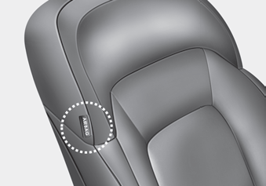
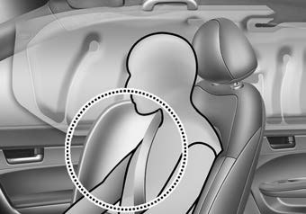

# Kia Sportage: Armação de air bag latera

[Home](../../index.md) / [Manual do proprietário do Kia Sportage SL](../sportage-1236.md) / [Recursos de segurança do seu veículo](sportage-1249.md) / [Air bag - sistema de retenção adicional avançado](sportage-1291.md) / Armação de air bag latera

O seu veículo está equipado com uma armação de air bag latera em cada assento do passageiro dianteiro.

O propósito do air bag é fornecer proteção adicional ao condutor e/ou ao passageiro dianteiro além daquela oferecida apenas pelo cinto de segurança.

- As armações de air bag laterais estão projetadas para se deslocar durante certos impactos laterais, dependendo da severidade, ângulo, velocidade e ponto de impacto do acidente.
- As armações de air bag laterais não se deslocam apenas do lado do impacto, mas também do lado oposto.
- Além disso, as armações de air bag laterais se deslocam em certas situações de rolamento.
- As armações de air bag laterais não estão projetadas para se deslocar em todos os impactos laterais ou situações de rolamento.

AVISO - Deslocamento imprevisto

*Evite impactos no sensor de armação de air bag latera quando o interruptor de ignição estiver ligado para evitar o deslocamento imprevisto da armação de air bag latera.*

- O air bag é suplementar ao sistema de cinto de segurança do condutor e do passageiro e não é uma substituição para eles. Portanto, os cintos de segurança devem ser usados em todo momento enquanto o veículo estiver em operação.
- Para a melhor proteção do sistema de air bag latera e para evitar ser ferido pelo deslocamento da armação de air bag latera, os dois ocupantes do assento dianteiro devem se sentar em uma posição ereta com o cinto de segurança corretamente amarrado. As mãos do condutor devem estar posicionadas no volante às 9:00 e 3:00. As mãos e os braços do passageiro devem estar posicionados nas pernas.

AVISO - Deslocamento

*Não instale nenhum acessório, incluindo tapetes de assento, ao lado ou próximo ao air bag latera, pois isso pode afetar o deslocamento das armações de air bag laterais.*

- Se o assento ou o tapete de assento estiver danificado, leve o veículo para reparo em um concessionário autorizado da Kia. Informe ao concessionário que o seu veículo está equipado com armações de air bag laterais e um sistema de detecção de ocupantes.

AVISO - Objetos voadores

*Não coloque nenhum objeto (um guarda-chuva, uma bolsa, etc.) entre a porta dianteira e o assento dianteiro. Esses objetos podem se tornar projéteis perigosos se a armação de air bag latera inflar.*
