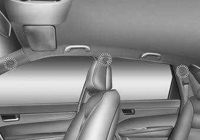
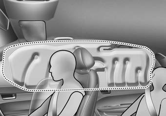

# Kia Sportage: Armação de air bag

[Home](../../index.md) / [Manual do proprietário Kia Sportage SL](../sportage-1236.md) / [Recursos de segurança do seu veículo](sportage-1249.md) / [Air bag - sistema de retenção adicional avançado](sportage-1291.md) / Armação de air bag

As armações de air bag estão localizadas ao longo dos dois lados das vigas do teto acima das portas dianteiras e traseiras.

Elas estão projetadas para ajudar a proteger as cabeças dos ocupantes das poltronas dianteiras e dos ocupantes das poltronas traseiras de borda em certos impactos laterais.

- As armações de air bag são projetadas para se deslocar em certos impactos laterais, dependendo da gravidade, ângulo, velocidade e ponto de impacto.
- As armações de air bag não se deslocam apenas do lado do impacto, mas também do lado oposto.
- Ambos os lados das armações de air bag se deslocam em certas situações de rolamento.
- As armações de air bag não são projetadas para se deslocar em todos os impactos laterais ou situações de rolamento.

Não permita que os passageiros inclinem suas cabeças ou corpos contra as portas, coloquem seus braços nas portas, estendam seus braços pela janela ou coloquem objetos entre as portas e os passageiros quando estiverem sentados em poltronas equipadas com air bags laterais e/ou de armação.

*✽ NOTA*

*Nunca tente abrir ou reparar qualquer componente do sistema de air bag de armação lateral. Isso deve ser feito apenas por um concessionário autorizado da Kia.*

Por que o meu air bag não se acionou em um acidente? (Condições de inflação e não-inflação do air bag)

Existem muitos tipos de acidentes em que o air bag não se espera que forneça proteção adicional.

Isso inclui impactos traseiros, segundos ou terceiros impactos em acidentes múltiplos e impactos de baixa velocidade.

- [Sensores de colisão do air bag](sportage-1303.md)
- [Condições de inflação do air bag](sportage-1304.md)
- [Condições de não-inflação do air bag](sportage-1305.md)
