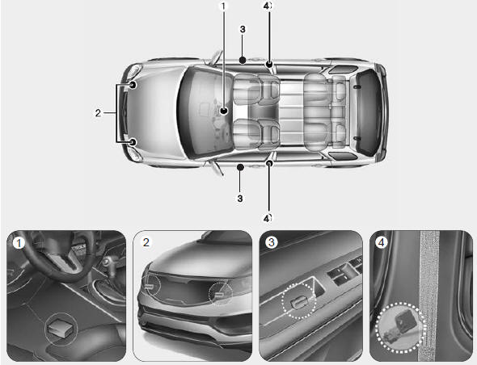

# Kia Sportage: Sensores de colisão do air bag

[Home](../../index.md) / [Manual do proprietário do Kia Sportage SL](../sportage-1236.md) / [Recursos de segurança do seu veículo](sportage-1249.md) / [Air bag - sistema de retenção adicional avançado](sportage-1291.md) / [Air bag de teto](sportage-1302.md) / Sensores de colisão do air bag

(1) Módulo de controle SRS / Sensor de rolo

(2) Sensor de impacto frontal

(3) Sensor de impacto lateral

(4) Sensor de impacto lateral

AVISO - Sensores do air bag

- *Não toque ou permita que objetos impactem as localizações onde os air bags
	ou os sensores estão instalados.

	Isto pode causar o despliegue imprevisto do air bag, o que pode resultar em lesões pessoais graves
	ou até mesmo a morte.*
- *Se a localização ou o ângulo dos sensores for alterado de qualquer forma, os air bags podem se desplegar quando não devem ou podem não se desplegar quando devem.

	Assim, não tente realizar manutenção ou ao redor dos sensores do air bag.
	Tenha o veículo verificado e reparado por um concessionário autorizado da Kia.*
- Problemas podem surgir se os ângulos de instalação dos sensores forem alterados devido à deformação do para-choques frontal, módulo frontal, carroceria ou portas laterais e/ou Pilar B onde estão instalados os sensores de impacto lateral. Tenha o veículo verificado e reparado por um concessionário autorizado da Kia.
- Seu veículo foi projetado para absorver impactos e desplegar os air bags em certas colisões. Instalar guardanapos de para-choque (ou passarela ou rodas de rolagem) ou substituir um para-choque (ou módulo da porta frontal) com peças não originais pode afetar negativamente o desempenho de colisão e despliegue do air bag do seu veículo.
