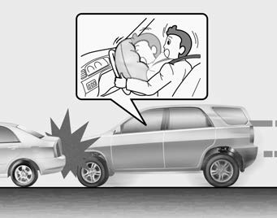
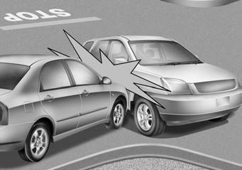
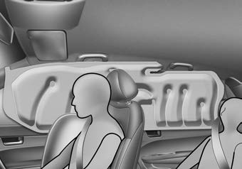

# Kia Sportage: Condições de inflação dos air bags

[Home](../../index.md) / [Manual do proprietário Kia Sportage SL](../sportage-1236.md) / [Recursos de segurança do seu veículo](sportage-1249.md) / [Air bag - sistema de retenção adicional avançado](sportage-1291.md) / [Air bag de cortina](sportage-1302.md) / Condições de inflação dos air bags

**Air bags do volante e do assento do passageiro dianteiro**

Os air bags do volante e do assento do passageiro dianteiro são projetados para inflar em colisões frontais dependendo da intensidade, velocidade ou ângulos da colisão frontal.

**Impacto lateral e/ou air bag de cortina**

Os air bags de impacto lateral e/ou de cortina são projetados para inflar quando um impacto é detectado pelos sensores de colisão lateral dependendo da força, velocidade ou ângulos do impacto resultante de uma colisão lateral.

Também, os air bags de impacto lateral e de cortina são projetados para inflar quando uma rolagem é detectada pelo sensor de rolagem.

Embora os air bags do volante e do assento do passageiro dianteiro (air bag do motorista e do passageiro dianteiro) sejam projetados para inflar apenas em colisões frontais, eles também podem inflar em outros tipos de colisões se os sensores de impacto frontal detectarem um impacto suficiente. Os air bags de impacto lateral e de cortina são projetados para inflar apenas em colisões laterais ou rolagens. No entanto, eles podem inflar em outros tipos de colisões ou situações semelhantes a rolagens, incluindo quando o veículo estiver inclinado, como quando estiver sendo puxado, se os sensores de impacto lateral ou de rolagem detectarem um impacto ou rolagem suficiente.

Se o chassis do veículo for impactado por buracos ou objetos em estradas não pavimentadas, os air bags podem se deslocar. Dirija com cuidado em estradas não pavimentadas ou em superfícies não projetadas para o tráfego de veículos para evitar o deslocamento não intencional dos air bags.
