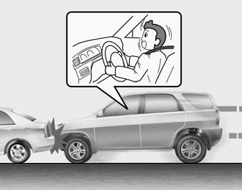
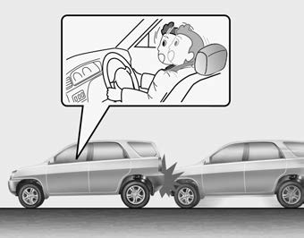
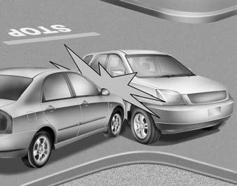
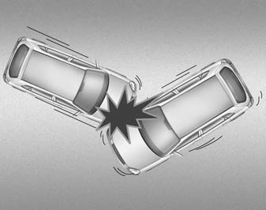
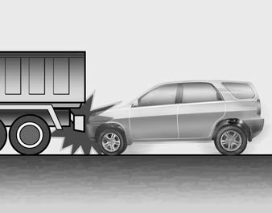
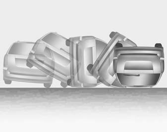
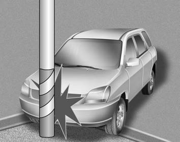

# Kia Sportage: Condições de não-deployamento do air bag

[Home](../../index.md) / [Manual do proprietário Kia Sportage SL](../sportage-1236.md) / [Recursos de segurança do seu veículo](sportage-1249.md) / [Air bag - sistema de suplemento de proteção avançado](sportage-1291.md) / [Air bag de cortina](sportage-1302.md) / Condições de não-deployamento do air bag

• Em colisões de baixa velocidade, os air bags podem não se desplegar. Os air bags estão projetados para não se desplegar em tais casos porque podem não fornecer benefícios além da proteção das cintas de segurança em tais colisões.

• Os air bags não estão projetados para inflar em colisões traseiras, pois os ocupantes são movidos para trás pela força do impacto. Nesse caso, air bags inflados não seriam capazes de fornecer qualquer benefício adicional.

• Os air bags frontais podem não se desplegar em colisões laterais, pois os ocupantes se movem na direção da colisão, e assim, na colisão lateral, a deployação do air bag frontal não forneceria proteção adicional aos ocupantes.

No entanto, se equipado com air bags laterais e de cortina, os air bags podem se desplegar dependendo da intensidade, velocidade do veículo e ângulos do impacto.

• Em colisões angulares, a força do impacto pode direcionar os ocupantes em uma direção onde os air bags não seriam capazes de fornecer qualquer benefício adicional, e assim, os sensores podem não se desplegar air bags.

• Perto do impacto, os condutores frequentemente freiam fortemente. Tal frenagem intensa abaixa a parte frontal do veículo, fazendo-o "rodar" sob um veículo com maior altura do solo. Os air bags podem não se desplegar nessa situação de "rodar sob" porque as forças de deceleração detectadas pelos sensores podem ser significativamente reduzidas por tais colisões "rodar sob".

• Os air bags frontais podem não se desplegar em acidentes de rolamento porque a deployação do air bag frontal não forneceria proteção adicional aos ocupantes.

No entanto, se equipado com air bags laterais e de cortina, os air bags podem se desplegar em um rolamento, quando detectado pelo sensor de rolamento.

• Os air bags podem não se desplegar se o veículo colidir com objetos como postes de iluminação ou árvores, onde o ponto de impacto está concentrado em uma área e a força total do impacto não é transmitida aos sensores.
