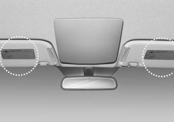
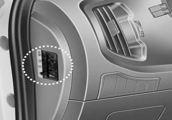

# Kia Sportage: Etiqueta de advertência do air bag

[Início](../../index.md) / [Manual do proprietário do Kia Sportage SL](../sportage-1236.md) / [Recursos de segurança do seu veículo](sportage-1249.md) / [Air bag - sistema de retenção adicional avançado](sportage-1291.md) / Etiqueta de advertência do air bag

As etiquetas de advertência do air bag, algumas exigidas pelas Normas de Segurança do Veículo do Canadá (CMVSS), estão fixadas no visor solar para alertar o condutor e os passageiros sobre os riscos potenciais do sistema de air bag.
