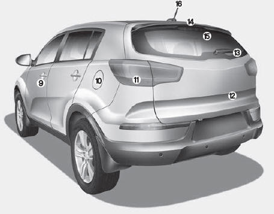

# Kia Sportage: Traseiro

[Início](../../index.md) / [Manual do proprietário do Kia Sportage SL](../sportage-1236.md) / [Visão geral do seu veículo](sportage-1242.md) / [Visão geral externa](sportage-1243.md) / Traseiro

9. Porta

10. Capacete de abastecimento de combustível

11. Lanterninha traseira

12. Porta-malas (porta-traseira)

13. Lâmina de limpador de vidro traseiro

14. Luz de frenagem de alta posição central

15. Defroster do vidro traseiro

16. Antena
