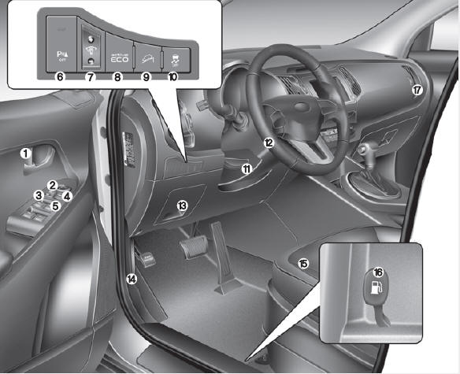

# Kia Sportage: Visão geral do interior

[Início](../../index.md) / [Manual do proprietário do Kia Sportage SL](../sportage-1236.md) / [Visão geral do seu veículo](sportage-1242.md) / Visão geral do interior

1. Botão de travamento/abertura da porta

2. Controle do espelho retrovisor externo

3. Interruptor do travamento central das portas

4. Botão de bloqueio da janela elétrica

5. Interruptores da janela elétrica

6. Botão de desligamento do sistema de auxílio de estacionamento traseiro

7. Interruptor de iluminação do painel de instrumentos

8. Botão Active ECO

9. Botão DBC

10. Botão ESC OFF

11. Controle de inclinação do volante

12. Volante

13. Caixa de fusíveis

14. Manivela de abertura do capô

15. Assentos

16. Manivela da tampa do tanque de combustível

17. Ventilação de ar
