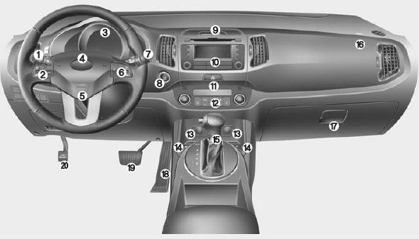

# Kia Sportage: Visão geral do painel de instrumentos

[Home](../../index.md) / [Manual do proprietário Kia Sportage SL](../sportage-1236.md) / [Conheça seu veículo](sportage-1242.md) / Visão geral do painel de instrumentos

1. Controles de iluminação / Sinais de direção

2. Controles de áudio do volante

3. Cluster de instrumentos

4. Buzina

5. Airbag do passageiro do motorista

6. Controles de cruise control

7. Interruptor limpador/espreguiçador

8. Botão DESENCADENAR/ENCERRAR MOTOR

9. Indicador de desativação do airbag do passageiro do motorista

10. Áudio

11. Sinalizador de advertência de perigo

12. Sistema de controle de temperatura

13. Saída de energia elétrica

14. Interruptor do aquecedor do assento (com ventilação)

15. Mando de marcha

16. Airbag do passageiro do motorista

17. Caixa de gavetas

18. Pedal do acelerador

19. Pedal do freio

20. Pedal do freio de estacionamento
