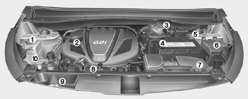
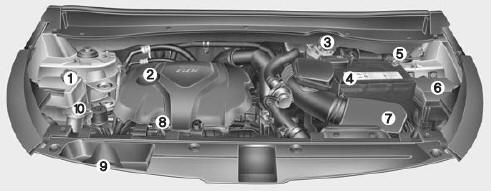

# Kia Sportage: Compartment do motor

[Home](../../index.md) / [Manual do proprietário do Kia Sportage SL](../sportage-1236.md) / [Seu veículo em um rápido olhar](sportage-1242.md) / Compartment do motor

Motor GDI

■ Motor T-GDI

1. Reservatório de líquido de arrefecimento do motor

2. Capo de adubo do motor

3. Reservatório de líquido de freio/embreagem*

4. Terminal positivo da bateria

5. Terminal negativo da bateria

6. Caixa de fusíveis

7. Filtro de ar

8. Marca de nível de óleo do motor

9. Tampa do radiador

10. Reservatório de líquido limpador de para-brisa
