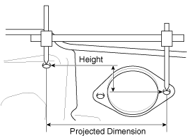
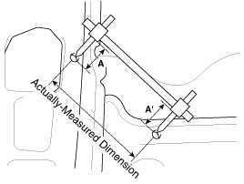
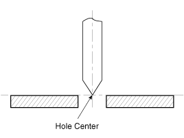

# Kia Sportage: Informações Gerais

[Home](../../index.md) / [Manual de Serviço e Reparo do Kia Sportage SL](../sportage-482.md) / [Corpo (Interior e Exterior)](sportage-934.md) / [Dimensões do Corpo](sportage-939.md) / Informações Gerais

## Geral

1. Basicamente, todas as medidas neste manual são realizadas com um marcador de rastreamento.

2. Quando uma cordinha métrica é usada, verifique se não há alongamento, torção ou curvatura.

3. Para medir dimensões, tanto as dimensões projetadas quanto as medidas reais são utilizadas neste manual.

## Método de Medição

Dimensões Projetadas

1. São as dimensões medidas quando os pontos de medição são projetados no plano de referência, e são as dimensões de referência utilizadas para alterações no corpo.

2. Se a extensão dos ponteiros do marcador de rastreamento for ajustável, faça a medição estendendo um ponteiro pelo valor equivalente à diferença na altura das duas superfícies.

   

Dimensões de Medição Real

1. Essas dimensões indicam a distância linear real entre os pontos de medição, e são as dimensões de referência para uso se um marcador de rastreamento for utilizado para medição.

2. Medir ajustando primeiro ambos os ponteiros para a mesma extensão (A=A'').

   > **Nota**
   >
   > - Verifique os ponteiros e o marcador em si para garantir que não haja movimento livre.

   

Ponto de Medição

1. As medições devem ser tomadas no centro das fendas.

   
