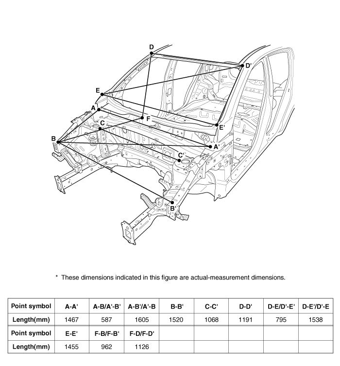
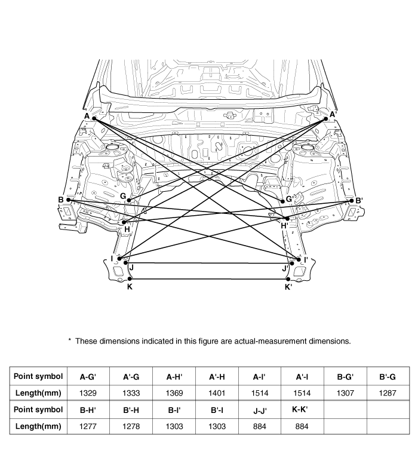
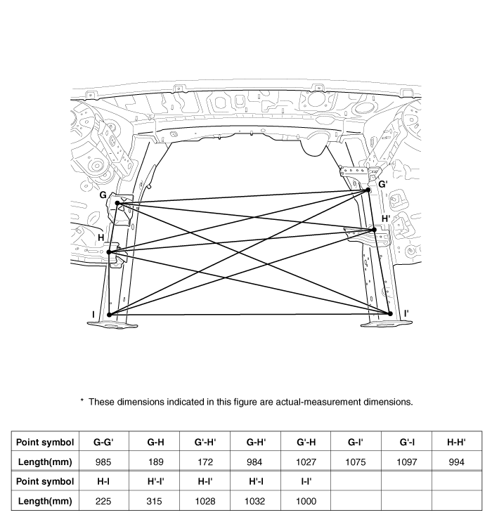

# Kia Sportage: Corpo Frente: Reparo do Corpo

[Home](../../index.md) / [Manual de Serviço e Reparo do Kia Sportage SL](../sportage-482.md) / [Corpo (Interior e Exterior)](sportage-934.md) / [Dimensões do Corpo](sportage-939.md) / Corpo Frente: Reparo do Corpo

## Corpo Frente A

| Buraco de montagem do travamento do capô (O12) | Buraco de ferramenta do painel da borda do para-choque (O8) | Buraco de montagem do suspensão frontal (O11) |
| --- | --- | --- |
| Canto do painel externo lateral | Canto do pilar frontal | Buraco de ferramenta do painel do cowl (O10) |

## Corpo Frente B

| Buraco de montagem do travamento do capô (O12) | Buraco de ferramenta do painel da borda do para-choque (O8) | Buraco de montagem do suporte do motor (O12) |
| --- | --- | --- |
| Buraco de montagem do transaxle (O16) | Buraco de montagem do suporte do motor (O14) | Buraco de montagem do transaxle (O16) |
| Buraco de ferramenta do membro lateral frontal (O10) | Buraco de ferramenta do membro lateral frontal (10X14) | Buraco de montagem do módulo frontal (O9) |
| Buraco de montagem do módulo frontal (O9) |  |  |

## Corpo Frente C

| Buraco de montagem do suporte do motor (O12) | Buraco de montagem do transaxle (O16) | Buraco de montagem do suporte do motor (O14) |
| --- | --- | --- |
| Buraco de montagem do transaxle (O16) | Buraco de ferramenta do membro lateral frontal (O14) | Buraco de ferramenta do membro lateral frontal (14X10) |
