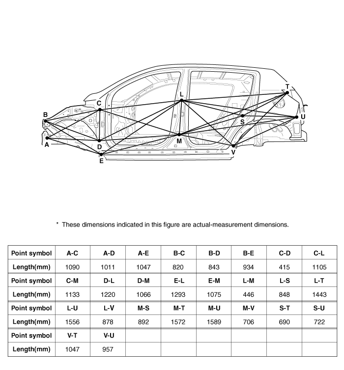
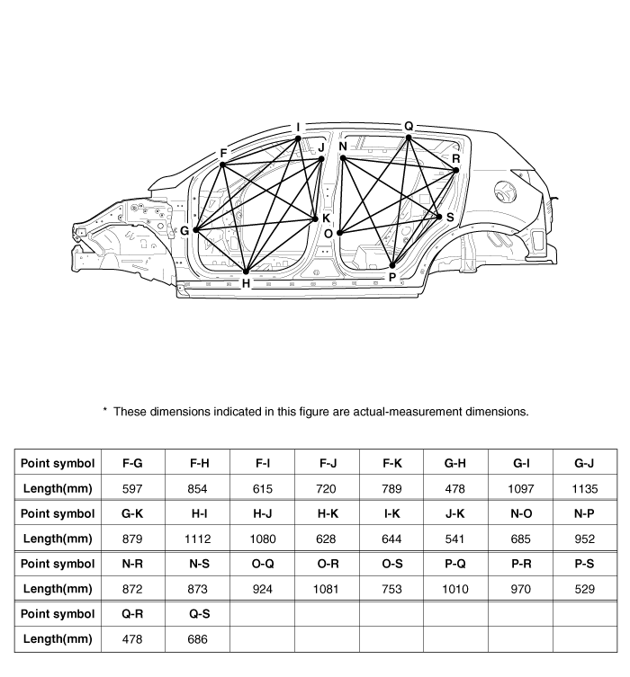

# Kia Sportage: Lado do Corpo: Reparo do Corpo

[Home](../../index.md) / [Manual de Serviço e Reparo do Kia Sportage SL](../sportage-482.md) / [Corpo (Interior e Exterior)](sportage-934.md) / [Dimensões do Corpo](sportage-939.md) / Reparo do Lado do Corpo

## Reparo do Lado do Corpo A

| Buraco de ferramenta do membro lateral frontal (O20) | Buraco de ferramenta do painel do para-choque (O10) | Buraco de montagem do pivô superior da porta frontal (O13) |
| --- | --- | --- |
| Buraco de montagem do pivô inferior da porta frontal (O13) | Buraco de montagem do painel do para-choque (O6.6) | Buraco de montagem do pivô superior da porta traseira (O10) |
| Buraco de montagem do pivô inferior da porta traseira (O13) | Buraco de montagem do interruptor da porta traseira (O13) | Buraco de montagem do farol combinado traseiro (O10) |
| Buraco de montagem do amortecedor traseiro (O6) | Buraco de montagem do revestimento do alçapão lateral (8.5X8.5) |  |

## Reparo do Lado do Corpo B

| Notch do painel externo lateral | Notch do painel externo lateral | Notch do painel externo lateral |
| --- | --- | --- |
| Notch do painel externo lateral | Notch do painel externo lateral | Buraco de montagem do interruptor da porta frontal (O10) |
| Notch do painel externo lateral | Notch do painel externo lateral | Notch do painel externo lateral |
| Notch do painel externo lateral | Notch do painel externo lateral | Buraco de montagem do interruptor da porta traseira (O10) |
