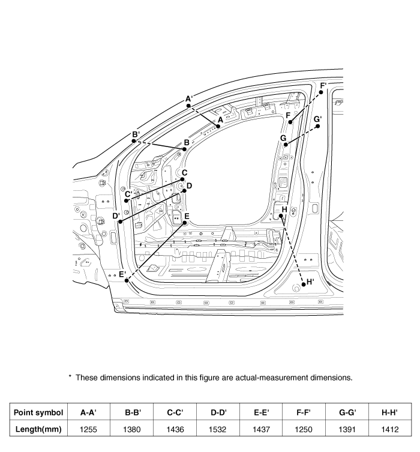
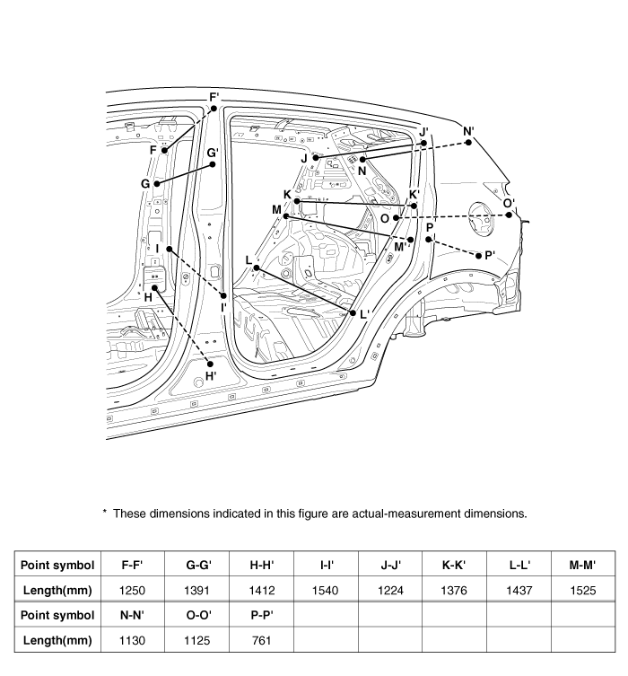
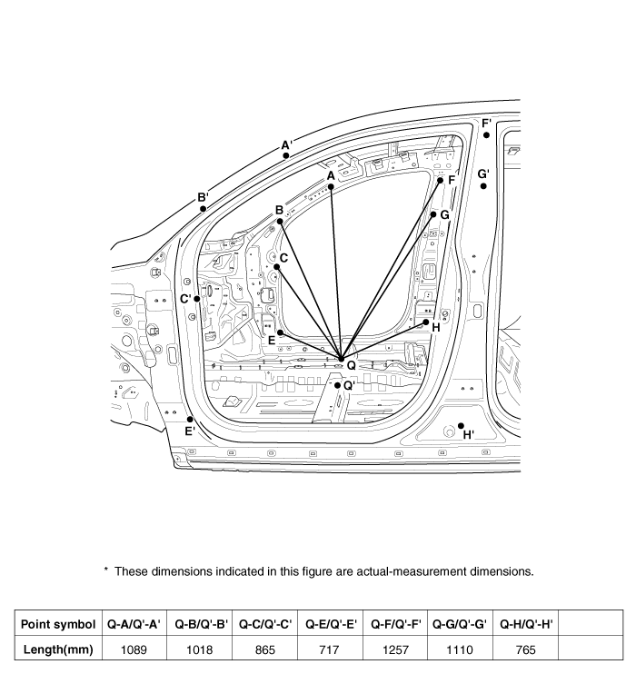
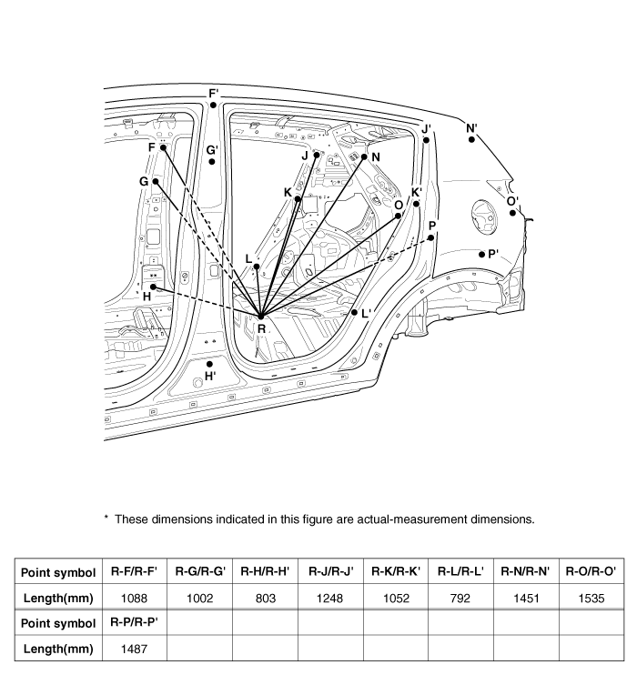

# Kia Sportage: Interior: Reparo do Corpo

[Home](../../index.md) / [Manual de Serviço e Reparo do Kia Sportage SL](../sportage-482.md) / [Corpo (Interior e Exterior)](sportage-934.md) / [Dimensões do Corpo](sportage-939.md) / Interior: Reparo do Corpo

## Interior A

| Buraco de montagem do acabamento do pilar frontal (O8,5) | Buraco de montagem do acabamento do pilar frontal (O7) | Buraco de montagem da barra transversal do cowl (O9) |
| --- | --- | --- |
| Buraco de montagem do cheker da porta frontal (O13) | Buraco de montagem do acabamento do lado do cowl (O8,5) | Buraco de montagem superior do ajustador da altura do cinto de segurança (O14,5) |
| Buraco de montagem inferior do ajustador da altura do cinto de segurança (O14,5) | Buraco de montagem do retractor do cinto de segurança do assento frontal (O12,2) |  |

## Interior B

| Buraco de montagem superior do ajustador da altura do cinto de segurança (O14,5) | Buraco de montagem inferior do ajustador da altura do cinto de segurança (O14,5) | Buraco de montagem do retractor do cinto de segurança do assento frontal (O12,2) |
| --- | --- | --- |
| Buraco de montagem do cheker da porta traseira (O13) | Buraco de montagem do ancinho do cinto de segurança do assento traseiro (O19) | Buraco de montagem do estribo da porta traseira (O9) |
| Buraco de ferramenta do painel do volante (O12) | Buraco de montagem do estribo da porta traseira (O13) | Buraco de montagem do acabamento do pilar traseiro (O8,5) |
| Buraco de montagem do acabamento do pilar traseiro (O8,5) | Buraco de montagem transversal do acabamento traseiro (O8,5) |  |

## Interior C

| Buraco de montagem do acabamento do pilar frontal (O8,5) | Buraco de montagem do acabamento do pilar frontal (O7) | Buraco de montagem da barra transversal do cowl (O9) |
| --- | --- | --- |
| Buraco de montagem do acabamento do lado do cowl (O8,5) | Buraco de montagem superior do ajustador da altura do cinto de segurança (O14,5) | Buraco de montagem inferior do ajustador da altura do cinto de segurança (O14,5) |
| Buraco de montagem do retractor do cinto de segurança do assento frontal (O12,2) | Buraco de montagem do assento frontal (O11) |  |

## Interior D

| Buraco de montagem superior do ajustador da altura do cinto de segurança (O14,5) | Buraco de montagem inferior do ajustador da altura do cinto de segurança (O14,5) | Buraco de montagem do retractor do cinto de segurança do assento frontal (O12,2) |
| --- | --- | --- |
| Buraco de montagem do ancinho do cinto de segurança do assento traseiro (O19) | Buraco de montagem do estribo da porta traseira (O9) | Buraco de ferramenta do painel do volante (O12) |
| Buraco de montagem do acabamento do pilar traseiro (O8,5) | Buraco de montagem do acabamento do pilar traseiro (O8,5) | Buraco de montagem transversal do acabamento traseiro (O8,5) |
| Buraco de ferramenta do painel traseiro (O6) |  |  |
