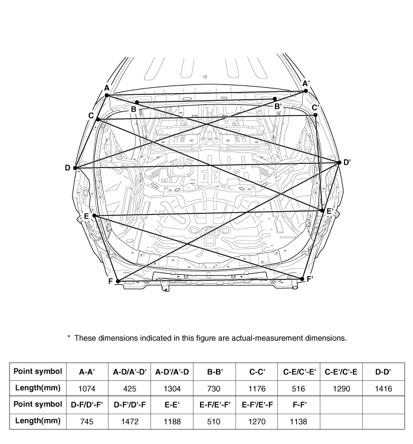

# Kia Sportage: Traseira do Corpo: Reparo do Corpo

[Home](../../index.md) / [Manual de Serviço e Reparo do Kia Sportage SL](../sportage-482.md) / [Corpo (Interior e Exterior)](sportage-934.md) / [Dimensões do Corpo](sportage-939.md) / Traseira do Corpo: Reparo do Corpo

| Painel externo lateral traseiro canto | Buraco de montagem da dobradiça traseira do porta-malas (O12) | Buraco de montagem do levantador do porta-malas (O9) |
| --- | --- | --- |
| Painel externo lateral traseiro canto | Buraco de montagem do bumerangue traseiro (8,5x8,5) | Buraco de montagem do bumerangue traseiro (14x16) |
| Buraco de montagem do bumerangue traseiro (14x16) |  |  |
